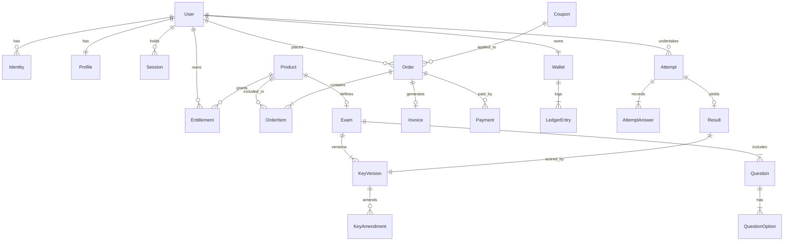

# سند معماری و مدل داده پایگاه داده کندرلب (Condorlab Data Architecture)

> **نسخه:** ۱٫۰ — طراحی جامع پایگاه داده رابطه‌ای و کش  
> **تاریخ:** آبان ۱۴۰۵  
> **مبنا:** `CONDORLAB_PRD_FA-V3.md` (نسخه ۳٫۳)، `CONDORLAB_MVP_FA.md` (نسخه ۲٫۳) و پیوست‌های ب و ح  
> **پایگاه داده:** PostgreSQL 16 (سیستم ثبت و ذخیره پایدار) + Redis 7 (قفل‌های آزمون، سشن‌ها، کش و صف‌ها)  
> **وضعیت:** سند مرجع پیاده‌سازی اسکیما، مایگریشن‌های Prisma و مدل‌های دامنه‌ای.  

---

## ۰. اصول بنیادین معماری داده

1. **دفترکل تغییرناپذیر (Append-Only Invariant):**
   - سوابق مالی (`LedgerEntry`)، فاکتورها (`Invoice`)، تلاش‌های آزمون (`Attempt`)، پاسخ‌های ثبت‌شده (`AttemptAnswer`)، کلیدهای آزمون (`KeyVersion`) و لاگ‌های حسابرسی (`AuditLog`) هرگز `UPDATE` یا `DELETE` فیزیکی نمی‌شوند. هرگونه اصلاح با ایجاد رکورد نسخه‌دار جدید ثبت می‌گردد.
2. **جداسازی سشن ورود از قفل آزمون:**
   - نشست‌های ورود کاربران به سایت در جدول `Session` و کلیدهای `user_sessions:{userId}` در ردیس ذخیره می‌شوند (سقف ۲ دستگاه).
   - قفل فعال دستگاه در آزمون در کلید جداگانه `exam_lock:{attemptId}` با لاجیک اختصاصی Lua مدیریت می‌شود (دقیقاً ۱ دستگاه فعال در لحظه).
3. **رزرو اتمیک ظرفیت و کوپن:**
   - فیلدهای ظرفیت آزمون (`capacity`) و سقف استفاده کوپن شکاری (`max_total_uses`) دارای شمارنده رزروهای فعال هستند تا در زمان رقابت ثبت‌نام (Race Condition) بیش‌فروشی (Over-selling) رخ ندهد.
4. **اتصال عمیق آزمون به بانک دانش (Knowledge Bank Linkage):**
   - هر سؤال دارای شناسه پایدار در جدول `Question` است و فیلدهای شناسه رفرنس کتاب کمپبل (جلد، فصل، صفحه) و برچسب‌های مبحثی را حمل می‌کند تا در کارنامه فراخوانی شوند.

---

## ۱. نمودار موجودیت-ارتباطات کلان (Conceptual ERD)



---

## ۲. اسکیمای تفصیلی جداول (PostgreSQL Tables)

### ۲٫۱. کاربران، هویت و پروفایل

#### جدول `users`
```sql
CREATE TABLE users (
    id UUID PRIMARY KEY DEFAULT gen_random_uuid(),
    role VARCHAR(32) NOT NULL DEFAULT 'Student', -- Student, ExamOfficer, ContentAdmin, Finance, Support, MasterAdmin, Grandmaster
    status VARCHAR(32) NOT NULL DEFAULT 'Pending_Verification', -- Pending_Verification, Active, Restricted, Suspended, Deletion_Pending
    is_owner BOOLEAN NOT NULL DEFAULT FALSE, -- فقط برای Grandmaster مقدار TRUE است
    created_at TIMESTAMPTZ NOT NULL DEFAULT NOW(),
    updated_at TIMESTAMPTZ NOT NULL DEFAULT NOW(),
    deleted_at TIMESTAMPTZ NULL
);
CREATE UNIQUE INDEX idx_users_single_owner ON users (is_owner) WHERE is_owner = TRUE;
```

#### جدول `identities` (چندروشی - آماده برای شماره/OTP در فاز B)
```sql
CREATE TABLE identities (
    id UUID PRIMARY KEY DEFAULT gen_random_uuid(),
    user_id UUID NOT NULL REFERENCES users(id) ON DELETE CASCADE,
    provider VARCHAR(32) NOT NULL, -- EMAIL_PASSWORD, GOOGLE, PHONE_OTP, TELEGRAM
    identifier VARCHAR(255) NOT NULL, -- ایمیل یا شماره موبایل یا Chat_ID تلگرام
    password_hash VARCHAR(255) NULL, -- هش رمز برای ایمیل
    is_verified BOOLEAN NOT NULL DEFAULT FALSE,
    verified_at TIMESTAMPTZ NULL,
    created_at TIMESTAMPTZ NOT NULL DEFAULT NOW(),
    CONSTRAINT uq_identities_provider_identifier UNIQUE (provider, identifier)
);
CREATE INDEX idx_identities_user_id ON identities(user_id);
```

#### جدول `profiles`
```sql
CREATE TABLE profiles (
    user_id UUID PRIMARY KEY REFERENCES users(id) ON DELETE CASCADE,
    first_name VARCHAR(64) NOT NULL,
    last_name VARCHAR(64) NOT NULL,
    phone_number VARCHAR(16) NULL, -- اختیاری در فاز A
    grade VARCHAR(8) NOT NULL CHECK (grade IN ('7', '8', '9', '10', '11')), -- پایه ۱۲ مسدود است
    city VARCHAR(64) NOT NULL,
    school VARCHAR(128) NOT NULL,
    telegram_chat_id BIGINT UNIQUE NULL, -- شناسه چت تلگرام متصل به کاربر
    telegram_username VARCHAR(64) NULL,
    bio TEXT NULL,
    updated_at TIMESTAMPTZ NOT NULL DEFAULT NOW()
);
```

#### جدول `support_tickets` (تیکتینگ و پشتیبانی چندکاناله)
```sql
CREATE TABLE support_tickets (
    id UUID PRIMARY KEY DEFAULT gen_random_uuid(),
    user_id UUID NOT NULL REFERENCES users(id) ON DELETE CASCADE,
    channel VARCHAR(32) NOT NULL DEFAULT 'telegram', -- telegram, web
    subject VARCHAR(255) NOT NULL,
    status VARCHAR(32) NOT NULL DEFAULT 'open', -- open, pending, closed
    created_at TIMESTAMPTZ NOT NULL DEFAULT NOW(),
    updated_at TIMESTAMPTZ NOT NULL DEFAULT NOW()
);
CREATE INDEX idx_support_tickets_user_id ON support_tickets(user_id);
```

---

### ۲٫۲. فروشگاه، ظرفیت، دسترسی و کوپن‌ها

#### جدول `products`
```sql
CREATE TABLE products (
    id UUID PRIMARY KEY DEFAULT gen_random_uuid(),
    slug VARCHAR(128) NOT NULL UNIQUE,
    type VARCHAR(32) NOT NULL, -- EXAM, COURSE, BUNDLE, PLAN
    title VARCHAR(255) NOT NULL,
    description TEXT NOT NULL,
    list_price_irr BIGINT NOT NULL CHECK (list_price_irr >= 0), -- به تومان صحیح
    access_policy VARCHAR(32) NOT NULL DEFAULT 'PURCHASE_REQUIRED', -- PUBLIC, LOGIN_REQUIRED, PURCHASE_REQUIRED, PLAN_REQUIRED
    status VARCHAR(32) NOT NULL DEFAULT 'Draft', -- Draft, Coming_Soon, Published, Capacity_Reached, Unavailable, Archived
    capacity INT NULL CHECK (capacity IS NULL OR capacity > 0), -- فیلد R-58 (null یعنی نامحدود)
    metadata JSONB NOT NULL DEFAULT '{}'::jsonb,
    created_at TIMESTAMPTZ NOT NULL DEFAULT NOW(),
    updated_at TIMESTAMPTZ NOT NULL DEFAULT NOW()
);
CREATE INDEX idx_products_type_status ON products(type, status);
```

#### جدول `coupons` (کدهای زمان‌دار و شکاری N نفر اول)
```sql
CREATE TABLE coupons (
    id UUID PRIMARY KEY DEFAULT gen_random_uuid(),
    code VARCHAR(32) NOT NULL UNIQUE,
    discount_type VARCHAR(16) NOT NULL, -- PERCENT, FIXED_AMOUNT
    discount_value BIGINT NOT NULL CHECK (discount_value > 0),
    max_total_uses INT NULL CHECK (max_total_uses IS NULL OR max_total_uses > 0), -- سقف استفاده کد شکاری (R-59)
    current_uses INT NOT NULL DEFAULT 0,
    starts_at TIMESTAMPTZ NOT NULL,
    ends_at TIMESTAMPTZ NOT NULL,
    min_order_amount BIGINT NOT NULL DEFAULT 0,
    allow_on_bundles BOOLEAN NOT NULL DEFAULT FALSE,
    campaign_ref VARCHAR(64) NULL,
    status VARCHAR(16) NOT NULL DEFAULT 'Scheduled', -- Scheduled, Active, Paused, Expired, Exhausted
    created_at TIMESTAMPTZ NOT NULL DEFAULT NOW(),
    CONSTRAINT chk_coupons_dates CHECK (ends_at > starts_at)
);
CREATE INDEX idx_coupons_code_status ON coupons(code, status);
```

#### جدول `entitlements` (مدل مجوز دسترسی - آماده اشتراک R-55)
```sql
CREATE TABLE entitlements (
    id UUID PRIMARY KEY DEFAULT gen_random_uuid(),
    user_id UUID NOT NULL REFERENCES users(id) ON DELETE CASCADE,
    product_id UUID NOT NULL REFERENCES products(id) ON DELETE RESTRICT,
    source VARCHAR(32) NOT NULL, -- PURCHASE, BUNDLE, PLAN, GRANT, GUEST
    valid_from TIMESTAMPTZ NOT NULL DEFAULT NOW(),
    valid_until TIMESTAMPTZ NULL, -- null یعنی دسترسی مادام‌العمر
    created_at TIMESTAMPTZ NOT NULL DEFAULT NOW(),
    CONSTRAINT uq_user_product_source UNIQUE (user_id, product_id, source)
);
CREATE INDEX idx_entitlements_user_active ON entitlements(user_id, valid_from, valid_until);
```

---

### ۲٫۳. مالی، سفارش، تسویه و کیف پول

#### جدول `orders`
```sql
CREATE TABLE orders (
    id UUID PRIMARY KEY DEFAULT gen_random_uuid(),
    order_number VARCHAR(32) NOT NULL UNIQUE, -- مثلاً ORD-1405-XXXXX
    user_id UUID NOT NULL REFERENCES users(id) ON DELETE RESTRICT,
    total_list_price BIGINT NOT NULL CHECK (total_list_price >= 0),
    discount_amount BIGINT NOT NULL DEFAULT 0,
    tax_amount BIGINT NOT NULL DEFAULT 0, -- مالیات ارزش افزوده
    payable_amount BIGINT NOT NULL CHECK (payable_amount >= 0),
    coupon_id UUID NULL REFERENCES coupons(id),
    status VARCHAR(32) NOT NULL DEFAULT 'Pending', -- Pending, Paid, Failed, Cancelled, Expired
    expires_at TIMESTAMPTZ NOT NULL, -- مهلت ۱۵ دقیقه‌ای پرداخت برای نگه‌داشت سهمیه ظرفیت و کوپن
    created_at TIMESTAMPTZ NOT NULL DEFAULT NOW(),
    paid_at TIMESTAMPTZ NULL
);
CREATE INDEX idx_orders_user_status ON orders(user_id, status);
```

#### جدول `order_items`
```sql
CREATE TABLE order_items (
    id UUID PRIMARY KEY DEFAULT gen_random_uuid(),
    order_id UUID NOT NULL REFERENCES orders(id) ON DELETE CASCADE,
    product_id UUID NOT NULL REFERENCES products(id) ON DELETE RESTRICT,
    unit_price BIGINT NOT NULL,
    discount_share BIGINT NOT NULL DEFAULT 0,
    final_price BIGINT NOT NULL
);
```

#### جدول `wallets` و `ledger_entries` (کیف پول دوگانه تغییرناپذیر)
```sql
CREATE TABLE wallets (
    id UUID PRIMARY KEY DEFAULT gen_random_uuid(),
    user_id UUID NOT NULL UNIQUE REFERENCES users(id) ON DELETE RESTRICT,
    bonus_balance BIGINT NOT NULL DEFAULT 0 CHECK (bonus_balance >= 0), -- غیرقابل برداشت
    cash_balance BIGINT NOT NULL DEFAULT 0 CHECK (cash_balance >= 0),  -- قابل برداشت
    created_at TIMESTAMPTZ NOT NULL DEFAULT NOW()
);

CREATE TABLE ledger_entries (
    id UUID PRIMARY KEY DEFAULT gen_random_uuid(),
    wallet_id UUID NOT NULL REFERENCES wallets(id) ON DELETE RESTRICT,
    balance_type VARCHAR(16) NOT NULL, -- BONUS, CASH
    direction VARCHAR(8) NOT NULL, -- CREDIT (افزایش), DEBIT (کاهش)
    amount BIGINT NOT NULL CHECK (amount > 0),
    balance_after BIGINT NOT NULL CHECK (balance_after >= 0),
    reference_type VARCHAR(32) NOT NULL, -- ORDER_PAYMENT, REFUND, CAMPAIGN_GIFT, WITHDRAWAL
    reference_id VARCHAR(64) NOT NULL,
    reason TEXT NOT NULL,
    created_at TIMESTAMPTZ NOT NULL DEFAULT NOW()
);
CREATE INDEX idx_ledger_wallet ON ledger_entries(wallet_id, created_at);
```

---

### ۲٫۴. بانک دانش و سؤالات (Knowledge Bank)

#### جدول `questions`
```sql
CREATE TABLE questions (
    id UUID PRIMARY KEY DEFAULT gen_random_uuid(),
    code VARCHAR(32) NOT NULL UNIQUE, -- مثلاً Q-BIO-C01-042
    question_type VARCHAR(16) NOT NULL, -- MCQ (چندگزینه‌ای), PROPOSITIONAL (گزاره‌ای), NUMERIC (عددی)
    body_text TEXT NOT NULL,
    image_url TEXT NULL,
    weight INT NOT NULL DEFAULT 1,
    
    -- فیلدهای اتصال به بانک دانش و کمپبل (R-60)
    campbell_volume INT NOT NULL,       -- جلد ۱ تا ۷
    campbell_chapter INT NOT NULL,      -- شماره فصل
    campbell_page_ref VARCHAR(32) NULL, -- صفحه مرجع
    main_topic VARCHAR(64) NOT NULL,    -- مبحث اصلی (ژنتیک، بیوشیمی، سلولی و...)
    subtopic VARCHAR(64) NULL,          -- زیرمبحث
    
    explanation_text TEXT NULL,         -- پاسخ تشریحی
    explanation_image_url TEXT NULL,
    is_verified BOOLEAN NOT NULL DEFAULT TRUE,
    created_by UUID NOT NULL REFERENCES users(id),
    created_at TIMESTAMPTZ NOT NULL DEFAULT NOW(),
    updated_at TIMESTAMPTZ NOT NULL DEFAULT NOW()
);
CREATE INDEX idx_questions_campbell ON questions(campbell_volume, campbell_chapter);
CREATE INDEX idx_questions_topic ON questions(main_topic);
```

#### جدول `question_options` (برای چندگزینه‌ای و گزاره‌ها)
```sql
CREATE TABLE question_options (
    id UUID PRIMARY KEY DEFAULT gen_random_uuid(),
    question_id UUID NOT NULL REFERENCES questions(id) ON DELETE CASCADE,
    option_order INT NOT NULL, -- ۱ تا ۵ برای گزینه‌ها، یا اندیس گزاره
    label VARCHAR(8) NOT NULL, -- الف، ب، ج، د، هـ یا A, B, C, D, E
    body_text TEXT NOT NULL,
    is_correct BOOLEAN NULL -- در کلید سنجیده می‌شود
);
```

---

### ۲٫۵. موتور آزمون، تلاش‌ها، کلیدها و کارنامه

#### جدول `exams`
```sql
CREATE TABLE exams (
    product_id UUID PRIMARY KEY REFERENCES products(id) ON DELETE RESTRICT,
    duration_minutes INT NOT NULL CHECK (duration_minutes > 0),
    official_start_at TIMESTAMPTZ NOT NULL,
    official_end_at TIMESTAMPTZ NOT NULL,
    open_mode_enabled BOOLEAN NOT NULL DEFAULT FALSE, -- تصمیم R-48
    open_start_at TIMESTAMPTZ NULL,
    open_end_at TIMESTAMPTZ NULL,
    open_price_irr BIGINT NULL,
    pdf_attachment_url TEXT NULL,
    allow_view_switch BOOLEAN NOT NULL DEFAULT TRUE, -- تغییر بین PDF و سؤالات وب
    default_view VARCHAR(16) NOT NULL DEFAULT 'SPLIT', -- PDF, QUESTIONS, SPLIT
    negative_marking_ratio NUMERIC(3,2) NOT NULL DEFAULT 0.33, -- یک‌سوم نمره منفی
    created_at TIMESTAMPTZ NOT NULL DEFAULT NOW()
);
```

#### جدول `key_versions` و `key_amendments` (اصلاح کلید و بازتصحیح R-50)
```sql
CREATE TABLE key_versions (
    id UUID PRIMARY KEY DEFAULT gen_random_uuid(),
    exam_id UUID NOT NULL REFERENCES exams(product_id) ON DELETE RESTRICT,
    version_number INT NOT NULL,
    is_active BOOLEAN NOT NULL DEFAULT FALSE,
    keys_payload JSONB NOT NULL, -- { [questionId]: { correctOption: 2, propositions: [true, false, ...] } }
    created_by UUID NOT NULL REFERENCES users(id),
    created_at TIMESTAMPTZ NOT NULL DEFAULT NOW(),
    CONSTRAINT uq_exam_key_version UNIQUE (exam_id, version_number)
);

CREATE TABLE key_amendments (
    id UUID PRIMARY KEY DEFAULT gen_random_uuid(),
    key_version_id UUID NOT NULL REFERENCES key_versions(id) ON DELETE CASCADE,
    question_id UUID NOT NULL REFERENCES questions(id),
    amendment_type VARCHAR(32) NOT NULL, -- DROP_QUESTION, DROP_PROPOSITION, DUAL_ANSWER, DUAL_KEY
    details JSONB NOT NULL,
    reason TEXT NOT NULL,
    created_at TIMESTAMPTZ NOT NULL DEFAULT NOW()
);
```

#### جدول `attempts`
```sql
CREATE TABLE attempts (
    id UUID PRIMARY KEY DEFAULT gen_random_uuid(),
    attempt_code VARCHAR(32) NOT NULL UNIQUE, -- مثلاً att_7f3k2m9q
    exam_id UUID NOT NULL REFERENCES exams(product_id) ON DELETE RESTRICT,
    user_id UUID NOT NULL REFERENCES users(id) ON DELETE RESTRICT,
    mode VARCHAR(16) NOT NULL, -- OFFICIAL, OPEN
    started_at TIMESTAMPTZ NOT NULL DEFAULT NOW(),
    expires_at TIMESTAMPTZ NOT NULL,
    submitted_at TIMESTAMPTZ NULL,
    is_auto_submitted BOOLEAN NOT NULL DEFAULT FALSE,
    status VARCHAR(16) NOT NULL DEFAULT 'In_Progress', -- In_Progress, Submitted, Evaluated
    created_at TIMESTAMPTZ NOT NULL DEFAULT NOW(),
    CONSTRAINT uq_user_exam_attempt UNIQUE (user_id, exam_id) -- یک تلاش برای هر کاربر در آزمون
);
CREATE INDEX idx_attempts_exam_user ON attempts(exam_id, user_id);
```

#### جدول `attempt_answers` (پاسخ‌های ثبت‌شده)
```sql
CREATE TABLE attempt_answers (
    id UUID PRIMARY KEY DEFAULT gen_random_uuid(),
    attempt_id UUID NOT NULL REFERENCES attempts(id) ON DELETE CASCADE,
    question_id UUID NOT NULL REFERENCES questions(id) ON DELETE RESTRICT,
    answer_payload JSONB NOT NULL, -- { selectedOption: 2, textNumeric: "42", propGrid: [1, 0, 1] }
    is_flagged BOOLEAN NOT NULL DEFAULT FALSE,
    version_seq INT NOT NULL DEFAULT 1,
    client_saved_at TIMESTAMPTZ NOT NULL,
    server_saved_at TIMESTAMPTZ NOT NULL DEFAULT NOW(),
    CONSTRAINT uq_attempt_question UNIQUE (attempt_id, question_id)
);
```

#### جدول `results` (کارنامه و رتبه)
```sql
CREATE TABLE results (
    id UUID PRIMARY KEY DEFAULT gen_random_uuid(),
    attempt_id UUID NOT NULL UNIQUE REFERENCES attempts(id) ON DELETE CASCADE,
    key_version_id UUID NOT NULL REFERENCES key_versions(id) ON DELETE RESTRICT,
    raw_score NUMERIC(6,2) NOT NULL,
    percentage NUMERIC(5,2) NOT NULL,
    correct_count INT NOT NULL,
    incorrect_count INT NOT NULL,
    unanswered_count INT NOT NULL,
    official_rank INT NULL, -- فقط برای آزمون رسمی
    open_percentile NUMERIC(5,2) NULL,
    topic_breakdown JSONB NOT NULL, -- سهم و درصد هر فصل کمپبل و مبحث اصلی (R-60)
    calculated_at TIMESTAMPTZ NOT NULL DEFAULT NOW()
);
CREATE INDEX idx_results_exam_rank ON results(official_rank);
```

---

## ۳. کلیدها و ساختار داده Redis

| کلید Redis | نوع داده | طول عمر (TTL) | کاربرد |
| :--- | :--- | :--- | :--- |
| `user_sessions:{userId}` | Hash | ۳۰ روز | ذخیره فراداده ۲ نشست فعال کاربر |
| `exam_lock:{attemptId}` | Hash | ۱۸۰ ثانیه | قفل تک‌دستگاهی آزمون (دستگاه فعال، نسخه قفل) |
| `exam_takeover_count:{attemptId}` | String (Int) | مدت آزمون | شمارنده تعداد Takeover (حداکثر ۲ بار) |
| `coupon_res:{couponCode}` | String (Int) | ۱۵ دقیقه | تعداد سهمیه‌های رزرو شده در سفارش‌های در انتظار |
| `capacity_res:{productId}` | String (Int) | ۱۵ دقیقه | تعداد سهمیه‌های رزرو شده ظرفیت آزمون در سبدها |
| `otp:{phoneNumber}` | String | ۱۲۰ ثانیه | کد یک‌بارمصرف ورود (فاز B) |

---

## ۴. وظایف آتی و بهبودهای سمت دیتابیس (Database TODOs & Enhancements)

> **توجه برای استقرار روی Supabase / سرور پایگاه داده:**  
> جهت سهولت در عملیات درج داده (`INSERT`) و جلوگیری از تحمیل محاسبات تکراری به کلاینت/بک‌اند، قابلیت‌های زیر باید در اسکیما و مایگریشن‌های سرور اعمال شوند:

1. **مقادیر پیش‌فرض هوشمند (`DEFAULT`)**:
   - تمامی شناسه‌های جدول‌ها به‌صورت پیش‌فرض از تابع `gen_random_uuid()` (برای فیلدهای UUID) یا `IDENTITY` برای شناسه‌های ترتیبی استفاده کنند تا در صورت پاس ندادن مقدار، خودکار مقداردهی شوند.
   - زمان‌بندی‌های `created_at` و `updated_at` دارای پیش‌فرض `now()` یا `timezone('utc'::text, now())` باشند.
   - وضعیت‌ها (مثل `status`) و فلگ‌های بولی مقادیر منطقی پیش‌فرض نظیر `'pending'` یا `FALSE` داشته باشند.

2. **تولید خودکار شناسه‌های کدگذاری‌شده و سفارشی (Custom / Computed IDs)**:
   - برای جدول‌هایی که شناسه خوانا دارند (مانند شماره سفارش، شماره فاکتور یا کد رهگیری به فرمت‌های مشخص مثل `INV-YYYY-XXXXX` یا `ORD-YYYY-XXXXX`):
     - تعریف `SEQUENCE` متناظر برای شمارش ترتیبی.
     - نوشتن تابع اختصاصی (Stored Function) برای ترکیب سال/تاریخ با پیشوند و مقدار Sequence.
     - تنظیم تابع به‌عنوان `DEFAULT` ستون یا استفاده از تریگر `BEFORE INSERT` (در مواردی که تولید کد به فیلدهای دیگر مثل شعبه، نوع سفارش یا دسته‌بندی وابستگی دارد).

3. **ستون‌های محاسباتی خودکار (`GENERATED ALWAYS AS ... STORED`)**:
   - ستون‌هایی که حاصل فرمول ریاضی یا ترکیب رشته‌ای بر روی سایر ستون‌های همان ردیف هستند (مانند مبالغ کل، تخفیف نهایی، اسلاگ‌ها و...) در سطح دیتابیس تعریف شوند تا بدون نیاز به محاسبه دستی در کلاینت در زمان درج ذخیره گردند.

4. **تریگر بروزرسانی خودکار (`BEFORE UPDATE`)**:
   - تنظیم تابع `handle_updated_at()` و تریگرهای مربوطه روی تمام جداول جهت به‌روزرسانی خودکار فیلد `updated_at`.

