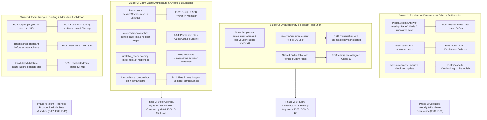
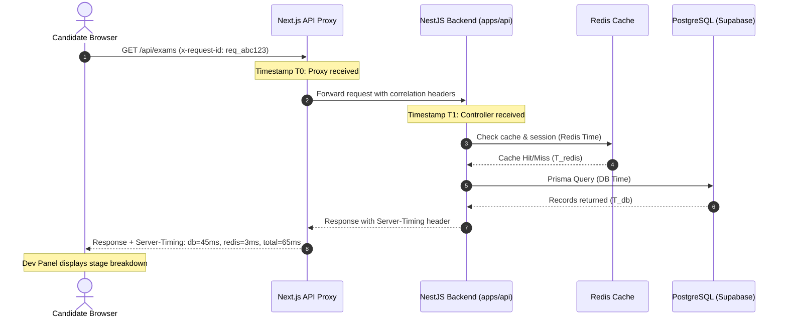
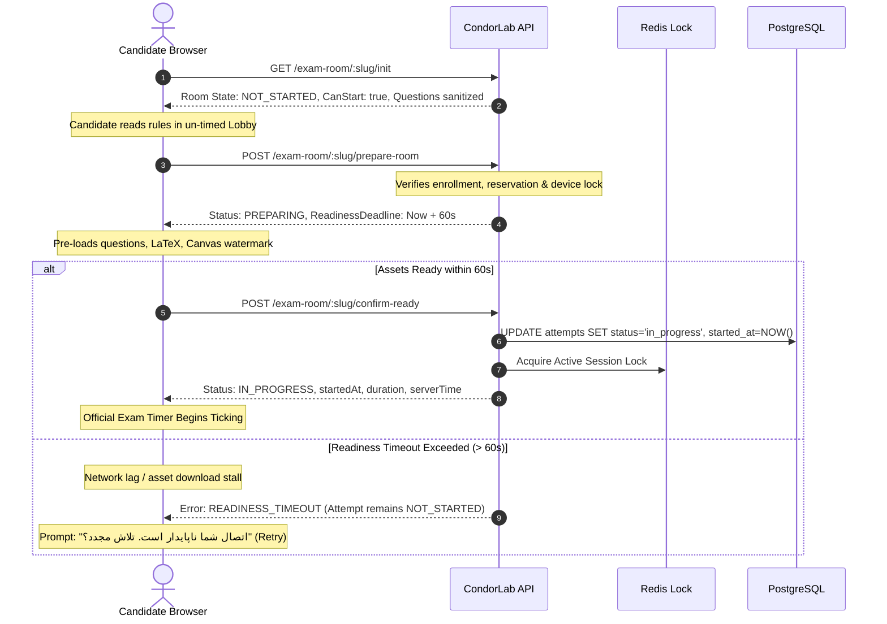

# CondorLab — Repository Audit and Comprehensive Remediation Plan

> **Deliverable Type:** Architecture Audit, Root-Cause Analysis & Remediation Strategy  
> **Status:** AUDIT & PLANNING ONLY (Ready for User Review — Implementation Pending Explicit User Approval and G1 Prerequisites)  
> **Authoritative Baseline:** `AGENTS.md`, `CONTRIBUTING.md`, `docs/CONDORLAB_PRD_FA-V3.md` (v3.3), `docs/CONDORLAB_ROADMAP_FA.md` (v1.2), `docs/CONDORLAB_SITEMAP_FA.md`, `docs/CONDORLAB_DATA_ARCHITECTURE_FA.md`  
> **Repository Deliverable Scope:** Sole deliverable of this phase is `plans.md`. No application code, schemas, or docs modified.

---

## Progress and Verification Checklist

- [x] Initial exploration & git tree verification
- [x] Governance and roadmap review (PRD decisions R-17 through R-66, G1 Gate prerequisites)
- [x] Workstream A: Next.js SSR Hydration & DevToolsOverlay Investigation
- [x] Workstream B: Exam Routes, Identity Resolution & Participant Lobby Gatekeeping
- [x] Workstream C & L: Store State, Inconsistent Products & Two-Layer Cache Architecture (SWR)
- [x] Workstream D: Intermittent Route Transitions, Cookie Base64 Decoding & Auth Guards
- [x] Workstream E: Roles, Permissions, Grandmaster Admin vs MasterAdmin & Dashboard Profiles
- [x] Workstream F: Student Answer Sheet, PostgreSQL Schema Gaps & Data Integrity
- [x] Workstream H: Exam Room Readiness Lifecycle, Server-Authoritative Timer & Platform Benchmarks
- [x] Workstream I & O: Admin Exam Creation Persistence, Question Types & Time Validation
- [x] Workstream J & K: Database Invariants, Capacity Rules & Free Exam Coupon Restrictions
- [x] Workstream M & N: Performance Bottlenecks, Waterfalls & Cross-Layer Dev Panel Diagnostics
- [x] Workstream P: Branded Product Naming Review (Status: NOT APPROVED — EXCLUDED per Mandatory Naming Freeze)
- [x] Section 1: Executive Summary
- [x] Section 2: Repository and Gate Assessment (G1 Audit, Gap Analysis & Sprint Scope)
- [x] Section 3: Findings Register (F-01 to F-12 Confirmed with Repository Evidence)
- [x] Section 4: Root-Cause and Corrected Dependency Map
- [x] Section 5: Prioritized Remediation Plan (Phases 1 - 4 Proposed; Renaming Excluded)
- [x] Section 6: Regression-Prevention Strategy & Verified Baseline Tests (Node 26/26 Unit Tests Executed; Integration Gaps Documented)
- [x] Section 7: Observability, Performance Analysis & Dev Panel Diagnostics (Hypotheses vs Confirmed Factors)
- [x] Section 8: Exam Readiness & Timer-Start Architecture (Proposed Recommendation Requiring User Approval)
- [x] Section 9: Proposed English AGENTS.md & Governance Guidelines (Draft Proposal for User Review)
- [x] Section 10: Mandatory Naming Freeze (No Renaming Permitted; Existing Terminology Preserved)
- [x] Section 11: Unresolved Decisions & Open Questions Requiring User Input
- [x] Section 12: Final Execution Readiness & Prerequisite Verification

---

## 1. Executive Summary

This comprehensive audit of the CondorLab repository was conducted following reported production-readiness issues across exam participation, student answer sheets, store caching, hydration failures, role-based dashboards, and admin panel persistence.

### Highest-Risk Findings Overview

1. **Student Answer Sheet Data Loss & Inconsistent Results (Critical Integrity Risk):**  
   The PostgreSQL `attempt_answers` table ([`packages/database/prisma/schema.prisma`](file:///Users/matinmousavi/Desktop/Condorlab/packages/database/prisma/schema.prisma#L234-L246)) only possesses a `selected_option` integer column. It lacks columns for multi-statement Stage 2 boolean answers (`selectedStatements`) and Stage 2 numeric calculations (`numericValue`). Furthermore, the controller request interfaces (`HeartbeatBody`, `SubmitBody`) and service `persistAnswers` omit these fields, dropping them before PostgreSQL persistence. Consequently, Stage 2 answers are only retained transiently in volatile Redis hashes. When Redis keys expire, restart, or when querying the database directly, all Stage 2 candidate inputs are lost, causing scores and answer keys to display inconsistently upon page refresh. In addition, answer persistence in `heartbeat` is unawaited (fire-and-forget), introducing a write-race condition upon rapid refresh.

2. **Unauthenticated Identity Impersonation & Participant Link Lobby Bug (Critical Security & Access Risk):**  
   In [`apps/api/src/modules/exam-room/exam-room.service.ts`](file:///Users/matinmousavi/Desktop/Condorlab/apps/api/src/modules/exam-room/exam-room.service.ts#L884-L904) (`resolveUser`), whenever a `userId` is not a valid UUID (such as controller requests passing default fallback `'demo_user'`), the service executes `this.prisma.client.user.findFirst()` instead of rejecting with HTTP 401. If the first user in the database (e.g. test admin) already submitted an attempt, any visitor opening a participation link with an unresolvable user ID is silently bound to that user and shown the message *"شما قبلاً این آزمون را به پایان رسانده‌اید"* (You have already completed this exam), leaking attempt records and blocking participation.

3. **Store State Desynchronization & Stale Guest Cache Serving (High User Impact):**  
   The client-side [`StoreCacheContext`](file:///Users/matinmousavi/Desktop/Condorlab/apps/web/src/context/store-cache-context.tsx#L24-L56) stores catalog data in a module-level variable `memoryStoreCatalog` and `sessionStorage` with `STALE_TIME_MS = Infinity` and zero `userId` tracking. Once an unauthenticated guest visits the store, the guest catalog is cached permanently. Logging in, switching users, or purchasing an exam never clears this cache because the context has no event listeners. Additionally, backend [`exams.service.ts`](file:///Users/matinmousavi/Desktop/Condorlab/apps/api/src/modules/exams/exams.service.ts#L125-L130) falls back to hardcoded `mockExams` whenever a database hiccup occurs, causing products to appear and disappear randomly between refreshes.

4. **Root Hydration Failure — DevToolsOverlay Synchronous SessionStorage Read (High Dev & Runtime Risk):**  
   [`apps/web/src/components/dev/devtools-overlay.tsx`](file:///Users/matinmousavi/Desktop/Condorlab/apps/web/src/components/dev/devtools-overlay.tsx#L50-L75) synchronously initializes `isOpen` from `sessionStorage` inside `useState(() => getPersistedState())`. During SSR, `isOpen` is `false` (rendering `<button>`), while during client hydration, `isOpen` is `true` (rendering `<div>`). Because this component is mounted in root [`app/layout.tsx`](file:///Users/matinmousavi/Desktop/Condorlab/apps/web/src/app/layout.tsx#L47), every single route throws a React 19 hydration mismatch error whenever DevTools has been opened.

5. **Silent Admin Creation Failure (Persistence Defect):**  
   In [`apps/api/src/modules/admin/admin.service.ts`](file:///Users/matinmousavi/Desktop/Condorlab/apps/api/src/modules/admin/admin.service.ts#L99-L121), the `createExam` method wraps `prisma.exam.create` in a `try/catch` that silently swallows any database constraint, schema, or date-parsing errors, pushes the exam to an in-memory array, and returns `{ success: true, fallback: true }`. The admin panel reports success, but the exam is never persisted to PostgreSQL.

---

## 2. Repository and Development Gate Assessment

### 2.1 Repository Architecture & Source Map

The repository is structured as an npm workspaces monorepo:
* **Frontend Web Application:** [`apps/web`](file:///Users/matinmousavi/Desktop/Condorlab/apps/web) — Next.js 15.0.3, React 19.0.0, TailwindCSS, Framer Motion. Uses Next.js App Router with Route Handlers acting as an API gateway proxy at [`apps/web/src/app/api/[...path]/route.ts`](file:///Users/matinmousavi/Desktop/Condorlab/apps/web/src/app/api/[...path]/route.ts).
* **Backend API Application:** [`apps/api`](file:///Users/matinmousavi/Desktop/Condorlab/apps/api) — NestJS 10.4.0, Express platform, `ioredis` for Redis session and exam locking, `cookie-parser`, RxJS.
* **Database Package:** [`packages/database`](file:///Users/matinmousavi/Desktop/Condorlab/packages/database) — Prisma ORM schema (`schema.prisma`), migrations, generated client.
* **Shared Package:** [`packages/shared`](file:///Users/matinmousavi/Desktop/Condorlab/packages/shared) — Shared TypeScript domain types, scoring algorithms, Persian verbal grade formatters (`formatGrade`), messages.
* **Infrastructure:** [`docker/docker-compose.yml`](file:///Users/matinmousavi/Desktop/Condorlab/docker/docker-compose.yml) — PostgreSQL 16 & Redis 7.

---

### 2.2 Development Gate G1 Audit — Roadmap Compliance

Under [`docs/CONDORLAB_ROADMAP_FA.md`](file:///Users/matinmousavi/Desktop/Condorlab/docs/CONDORLAB_ROADMAP_FA.md#L293-L312) Section 10 and [`CONTRIBUTING.md`](file:///Users/matinmousavi/Desktop/Condorlab/CONTRIBUTING.md#L100-L108) Section 7, production product code was restricted until the closure of **Green Gate G1**. The repository currently contains extensive application code across both frontend and backend.

Here is the objective audit of the 13 mandatory G1 prerequisites:

| # | G1 Prerequisite Condition | Documented Mandate | Actual Repository Status | Audit Assessment |
|---|---|---|---|---|
| **1** | Payment gateway selected with test key | PRD 5.2.8, Roadmap 10.1 | Sandbox dummy refs (`SANDBOX-${Date.now()}`) and zero-invoice mocks in [`checkout.service.ts`](file:///Users/matinmousavi/Desktop/Condorlab/apps/api/src/modules/checkout/checkout.service.ts#L583). No real gateway provider or credentials configured. | **Incomplete / Mocked** |
| **2** | Domain, transactional email & SPF/DKIM active | PRD 6.1.3, Roadmap 10.2 | No transactional email client integrated; email notifications are logged to console or in-memory. | **Incomplete** |
| **3** | Wireframes for 22 key pages approved | PRD 3.2, UX Guide | Defined in [`docs/CONDORLAB_WIREFRAMES_FA.md`](file:///Users/matinmousavi/Desktop/Condorlab/docs/CONDORLAB_WIREFRAMES_FA.md), but code has diverged (e.g., admin pages built without full wireframe signoff). | **Partially Complete** |
| **4** | Vector logo, final palette & component library | Product Brief, UX Guide | Favicon SVG, base UI buttons, dialogs, inputs exist. | **Complete for MVP** |
| **5** | Approved ERD & API contracts | Data Architecture, Tech Stack | Incomplete schema: `AttemptAnswer` missing Stage 2 fields (`selected_statements`, `numeric_value`); questions mocked in TS files. | **Deficient / Discrepant** |
| **6** | Stack & queue decision recorded (ADR) | Roadmap 10.6 | NestJS/Next.js/Redis implemented, but queue mechanism (BullMQ) is absent; tasks run in-process. | **Partially Complete** |
| **7** | Legal documents & parental consent approved | PRD 5.8, Roadmap 10.7 | Documented in PRD, but no parental consent flow in checkout or registration. | **Incomplete** |
| **8** | Three environments (Dev, Staging, Prod) & green CI | Roadmap 10.8 | GitHub workflow exists in `.github/workflows/`, but staging/production pipelines unverified. | **Unverifiable** |
| **9** | Critical test checklist defined | Contributing 8, Roadmap 10.9 | Unit test suites exist in [`tests/`](file:///Users/matinmousavi/Desktop/Condorlab/tests) (26/26 pass via `node --test tests/*.test.mjs`), but end-to-end checkout, live DB persistence, and multi-device SSE integration tests remain unexecuted. | **Partially Verified (Unit Only)** |
| **10**| First exam content & test accounts ready | Roadmap 10.10 | 4 pilot exams seeded; test users seeded via `DEDICATED_TEST_USERS`. | **Complete for Pilot** |
| **11**| Mobile 360px viewport verified (R-57) | PRD 3.2 (R-57) | Mobile navigation, responsive OMR drawer implemented, but Stage 2 dual-view needs testing on real devices. | **Partially Complete** |
| **12**| Layout Skeletons for all data pages (R-56) | PRD 3.2 (R-56) | Shimmer/skeleton placeholders implemented in catalog, exam detail, dashboard, and admin. | **Complete** |
| **13**| `Plan/Entitlement(source, valid_until)` model in ERD (R-55) | PRD 5.2.2.1, Roadmap 10.13 | **Missing from Prisma Schema.** Schema only has `Order` and `LedgerEntry`, causing fragile string matching on descriptions in [`dashboard.service.ts:198`](file:///Users/matinmousavi/Desktop/Condorlab/apps/api/src/modules/dashboard/dashboard.service.ts#L198). | **Incomplete (Blocker)** |

### G1 Finding, Ambiguity Analysis & Governance Boundary

> [!IMPORTANT]
> **Definitive Gate G1 Status: INCOMPLETE / BLOCKED.**  
> Exactly 3 of the 13 mandatory G1 prerequisites (#4, #10, #12) are fully complete. 4 prerequisites (#3, #6, #9, #11) are only partially complete or partially verified, and 6 prerequisites (#1, #2, #5, #7, #8, #13) are incomplete, deficient, mocked, or unverifiable. Therefore, 10 of the 13 prerequisites are not fully satisfied, and Gate G1 is definitively blocked. Substantial application code was created prior to the formal sign-off of Green Gate G1.

#### Analysis of Ambiguity Between G1 and Remediation Work:
1. **The Governance Conflict:**  
   [`docs/CONDORLAB_ROADMAP_FA.md:7`](file:///Users/matinmousavi/Desktop/Condorlab/docs/CONDORLAB_ROADMAP_FA.md#L7) sets a strict rule: *"هیچ خط کد محصول تا بستن دروازه‌ی سبز (G1) نوشته نمی‌شود"* (No product code is written until G1 is closed). In reality, extensive product code was already written in `apps/web` and `apps/api`, and this existing code suffers from severe data-loss bugs (F-06) and security vulnerabilities (F-02).
2. **The Procedural Ambiguity:**  
   Does fixing verified defects in existing pre-G1 code constitute "product development" that must be blocked until non-technical G1 prerequisites (such as real banking lead times, legal consent, and external transactional email contracts) are closed? Or should the technical remediation of existing code be authorized as a focused **G1 Alignment & Technical Remediation Sprint**?
3. **Strict Gate Preservation (No Implicit Waiver):**  
   - This plan does **not** assume, claim, or imply that G1 has passed.
   - Passing isolated unit tests (26/26) does **not** satisfy G1.
   - G1 cannot be bypassed, waived, or satisfied implicitly.
   - Moving into remediation requires the product owner / user to formally resolve this procedural ambiguity (see Section 11, Question 3).

#### Mandatory Prerequisites Required Before Any Implementation May Begin:
1. **User Decision on Governance Scope:** Explicit user authorization of Unresolved Decision 3 (authorizing the schema migration for `AttemptAnswer` and technical bug fixes as a preparatory G1 sprint).
2. **User Decision on Architecture Proposals:** Explicit user decisions on Unresolved Decisions 1, 2, and 4 (readiness timeout, profile modeling, route reconciliation).
3. **Explicit Implementation Authorization:** Written user approval specifically authorizing coding agents to begin Phase 1 implementation. Under no circumstances may implementation proceed based solely on the review or finalization of this planning document.

---

## 3. Findings Register

### Finding F-01: React 19 / Next.js SSR Hydration Tag Mismatch in `DevToolsOverlay`
* **Validation Status:** `[STATUS: CONFIRMED]`
* **Severity:** Medium | **Priority:** P1 (Blocks clean development and masks real application errors)
* **Affected Feature:** Global application layout across all routes in development mode (`process.env.NODE_ENV === 'development'`).
* **Reproduction Status:** Confirmed reproducible.
  1. Start application with `npm run dev`.
  2. Open DevTools panel via shortcut `Ctrl+Shift+D` (persisting `{ isOpen: true }` in `sessionStorage`).
  3. Refresh the page or navigate to any route.
  4. Inspect browser console: `Unhandled Runtime Error: Hydration failed because the server-rendered HTML didn't match the client. Expected server HTML to contain a matching <div> in <div> but got <button>`.
* **Expected vs Actual Behavior:**
  * *Expected:* Server-rendered HTML and client initial hydration tree must be identical.
  * *Actual:* Server renders `<button>` (because `typeof window === 'undefined'` forces `isOpen = false`), while the client synchronously reads `sessionStorage` in `useState` during initial render and renders `<div>`.
* **Evidence & Exact References:**
  * [`apps/web/src/components/dev/devtools-overlay.tsx:50-57`](file:///Users/matinmousavi/Desktop/Condorlab/apps/web/src/components/dev/devtools-overlay.tsx#L50-L57): `getPersistedState()` returns `{}` on server, but parses `sessionStorage` on client.
  * [`apps/web/src/components/dev/devtools-overlay.tsx:70-71`](file:///Users/matinmousavi/Desktop/Condorlab/apps/web/src/components/dev/devtools-overlay.tsx#L70-L71): `const [isOpen, setIsOpen] = useState(() => initialPersisted.isOpen ?? false)`.
  * [`apps/web/src/components/dev/devtools-overlay.tsx:373-376`](file:///Users/matinmousavi/Desktop/Condorlab/apps/web/src/components/dev/devtools-overlay.tsx#L373-L376): Renders `<button>` when `!isOpen`.
  * [`apps/web/src/components/dev/devtools-overlay.tsx:389-395`](file:///Users/matinmousavi/Desktop/Condorlab/apps/web/src/components/dev/devtools-overlay.tsx#L389-L395): Renders `<div>` when `isOpen`.
  * [`apps/web/src/app/layout.tsx:47`](file:///Users/matinmousavi/Desktop/Condorlab/apps/web/src/app/layout.tsx#L47): Mounted at root body level.
* **Confirmed Root Cause:** Non-deterministic synchronous initialization from browser-only storage (`sessionStorage`) inside a component rendered during SSR, combined with structural tag divergence (`<button>` vs `<div>`).
* **Data-Integrity / Security Risk:** Low, but severely impairs developer velocity and triggers client-side full re-render cascades.
* **PRD/Documentation Requirements:** PRD 3.2, UX Guide (zero layout shift, clean SSR rendering).
* **User Clarification Required:** No. Purely technical defect.

---

### Finding F-02: Silent Fallback to First Database User in Exam Room Initialization
* **Validation Status:** `[STATUS: CONFIRMED]`
* **Severity:** Critical | **Priority:** P0 (Severe Security Vulnerability & Exam Participation Blocker)
* **Affected Feature:** Exam participation link, lobby initialization, candidate attempt access.
* **Reproduction Status:** Confirmed reproducible by code inspection.
  1. An exam participation request reaches [`GET /api/exam-room/:identifier/init`](file:///Users/matinmousavi/Desktop/Condorlab/apps/api/src/modules/exam-room/exam-room.controller.ts#L60-L68).
  2. While `ExamRoomController` is decorated with `@UseGuards(AuthGuard)` at class level (line 41), handler methods supply permissive fallback literals: `user?.id || 'demo_user'`, `user?.sessionId || 'sess_demo'`.
  3. `resolveUser('demo_user')` runs in [`apps/api/src/modules/exam-room/exam-room.service.ts:884-904`](file:///Users/matinmousavi/Desktop/Condorlab/apps/api/src/modules/exam-room/exam-room.service.ts#L884-L904). Because `'demo_user'` is not a UUID, `findUnique` is bypassed, and line 898 executes: `user = await this.prisma.client.user.findFirst({ include: { profile: true } })`.
  4. The backend silently binds the session to the first user found in PostgreSQL (e.g. test admin).
  5. Furthermore, `isUserEnrolledInExam` ([`exam-room.service.ts:923-925`](file:///Users/matinmousavi/Desktop/Condorlab/apps/api/src/modules/exam-room/exam-room.service.ts#L923-L925)) returns `true` unconditionally for any non-UUID `userId`, completely bypassing enrollment verification.
  6. If that first database user has an attempt with `status = 'submitted'`, `initRoom` returns `isSubmitted: true` with message *"شما قبلاً این آزمون را به پایان رسانده و پاسخ‌برگ را ارسال کرده‌اید"*, exposing another user's attempt status and blocking candidate entry.
* **Expected vs Actual Behavior:**
  * *Expected:* Unauthenticated or unresolvable candidate requests MUST be rejected with HTTP 401 Unauthorized, never bound to an arbitrary database user.
  * *Actual:* Requests with non-UUID or unresolvable IDs are silently bound to the first database user, exposing that user's attempt status, answers, and falsely claiming the participant has already submitted.
* **Evidence & Exact References:**
  * [`apps/api/src/modules/exam-room/exam-room.controller.ts:41, 60-68`](file:///Users/matinmousavi/Desktop/Condorlab/apps/api/src/modules/exam-room/exam-room.controller.ts#L41): Class has `@UseGuards(AuthGuard)`, but handler defaults to `user?.id || 'demo_user'` and `user?.sessionId || 'sess_demo'`.
  * [`apps/api/src/modules/exam-room/exam-room.service.ts:884-901`](file:///Users/matinmousavi/Desktop/Condorlab/apps/api/src/modules/exam-room/exam-room.service.ts#L884-L901): `resolveUser` falls back to `findFirst()`.
  * [`apps/api/src/modules/exam-room/exam-room.service.ts:923-925`](file:///Users/matinmousavi/Desktop/Condorlab/apps/api/src/modules/exam-room/exam-room.service.ts#L923-L925): `isUserEnrolledInExam` returns `true` if `userId` is not a UUID.
  * [`apps/api/src/modules/exam-room/exam-room.service.ts:261-304`](file:///Users/matinmousavi/Desktop/Condorlab/apps/api/src/modules/exam-room/exam-room.service.ts#L261-L304): If first user's attempt is submitted, returns `isSubmitted: true`.
* **Confirmed Root Cause:** Unsafe query fallback in `ExamRoomService.resolveUser` (which queries `prisma.user.findFirst()` when `userId` is not a UUID or not found in the database) combined with permissive default arguments (`'demo_user'`) in `ExamRoomController`. (Correction: The controller does NOT lack `@UseGuards(AuthGuard)`; the guard is present on the controller class, but handler default parameters and service fallback logic bypass intended candidate isolation without requiring a broad authentication redesign).
* **Data-Integrity / Security Risk:** Critical data exposure (violates PRD 5.3.8 and privacy mandates) and breaks candidate exam admission.
* **PRD/Documentation Requirements:** PRD 4.3, 5.3.8, `CONDORLAB_SITEMAP_FA.md` Section 0 ("Protected paths must never open without authorization").
* **User Clarification Required:** No. Standard security requirement.

---

### Finding F-03: Exam Attempt & Route URL Architecture Discrepancy
* **Validation Status:** `[STATUS: CONFIRMED — Route discrepancy verified; Route renaming/deprecation NOT APPROVED per mandatory naming freeze]`
* **Severity:** High | **Priority:** P1 (Routing Integrity & State Machine Consistency)
* **Affected Feature:** Exam lobby, room navigation, answer sheet summary, and report card routes.
* **Reproduction Status:** Confirmed discrepancy between documentation and code.
* **Expected vs Actual Behavior:**
  * *Documented in Sitemap (`CONDORLAB_SITEMAP_FA.md:36-41, 90-91`):*
    * Public exam detail: `/exams/[slug]`
    * Participant active exam room: `/exam/[attemptId]` or `/exam/[attemptId]/room` (stable attempt identity)
    * Candidate results / report card: `/results/[attemptId]`
    * Public leaderboard: `/leaderboard/[slug]`
  * *Actual Implementation in Code:*
    * Both `/exams/[slug]/room` and `/exam/[id]/room` exist simultaneously.
    * `/exams/[slug]/room` proxies directly to `/exam/[id]/room` by passing `slug` as `id` ([`apps/web/src/app/exams/[slug]/room/page.tsx:1-7`](file:///Users/matinmousavi/Desktop/Condorlab/apps/web/src/app/exams/[slug]/room/page.tsx#L1-L7)).
    * The exam room views treat `[id]` as a polymorphic parameter (sometimes exam UUID, sometimes exam slug, sometimes attempt UUID).
  * *Naming Freeze Mandate:*
    * Per the mandatory project naming freeze, existing routes (`/exams/[slug]/room`, `/exam/[id]/room`) must **remain unchanged and must not be renamed or deprecated**. Internal attempt resolution must resolve the candidate's active attempt on the server without altering existing public or authenticated URLs.
* **Evidence & Exact References:**
  * [`docs/CONDORLAB_SITEMAP_FA.md:36-41`](file:///Users/matinmousavi/Desktop/Condorlab/docs/CONDORLAB_SITEMAP_FA.md#L36-L41): Canonical route structure specification.
  * [`apps/web/src/app/exams/[slug]/room/page.tsx:5`](file:///Users/matinmousavi/Desktop/Condorlab/apps/web/src/app/exams/[slug]/room/page.tsx#L5): Forwarding slug as `id`.
  * [`apps/web/src/app/exam/[id]/room/page.tsx:71`](file:///Users/matinmousavi/Desktop/Condorlab/apps/web/src/app/exam/[id]/room/page.tsx#L71): Ambiguous identifier used for room init.
* **Confirmed Root Cause:** Fragmented incremental development creating duplicate route aliases rather than implementing the documented sitemap hierarchy.
* **Data-Integrity / Security Risk:** Mutable slug used as attempt identifier causes race conditions when multiple users or attempts share a slug.
* **PRD/Documentation Requirements:** `CONDORLAB_SITEMAP_FA.md` Section 0 & Section 2; User Request Workstream B direction.
* **User Clarification Required:** No on server-side attempt resolution; route renaming is frozen and rejected.

---

### Finding F-04: Permanent Stale Guest Catalog Serving & Lack of User Scoping in `StoreCacheContext`
* **Validation Status:** `[STATUS: CONFIRMED]`
* **Severity:** High | **Priority:** P1 (Financial and Entitlement State Desynchronization)
* **Affected Feature:** Store Catalog (`/exams`), user product cards, purchase action buttons.
* **Reproduction Status:** Confirmed reproducible by code inspection.
  1. Visit `/exams` as an unauthenticated guest.
  2. `fetchStoreCatalog` queries `/api/exams`, receives guest catalog, stores it in `memoryStoreCatalog` and `sessionStorage['condor_store_catalog_cache']` with `STALE_TIME_MS = Infinity`.
  3. User logs in, purchases an exam, or switches role in DevTools.
  4. Navigate back to `/exams` or refresh.
  5. `fetchStoreCatalog` checks `if (!force && memoryStoreCatalog && Date.now() - timestamp < Infinity)` -> evaluates to `true`!
  6. The client renders the stale unauthenticated catalog forever; newly enrolled status is not reflected.
* **Expected vs Actual Behavior:**
  * *Expected:* Client store catalog must revalidate upon authentication change, purchase completion, or user switch.
  * *Actual:* Guest data persists indefinitely in memory and `sessionStorage`.
* **Evidence & Exact References:**
  * [`apps/web/src/context/store-cache-context.tsx:22`](file:///Users/matinmousavi/Desktop/Condorlab/apps/web/src/context/store-cache-context.tsx#L22): `const STALE_TIME_MS = Infinity`.
  * [`apps/web/src/context/store-cache-context.tsx:54`](file:///Users/matinmousavi/Desktop/Condorlab/apps/web/src/context/store-cache-context.tsx#L54): Bypasses network request whenever `memoryStoreCatalog` exists.
  * [`apps/web/src/context/store-cache-context.tsx`](file:///Users/matinmousavi/Desktop/Condorlab/apps/web/src/context/store-cache-context.tsx): Contains zero event listeners for `condor_auth_change`, `condor:invalidate:all`, or user identity changes.
* **Confirmed Root Cause:** Client-side cache architecture lacking user-scoping (`userId`), cache invalidation subscriptions, and appropriate TTL boundaries.
* **Data-Integrity / Security Risk:** Candidate sees incorrect enrollment status, leading to duplicate purchase attempts or confusion.
* **PRD/Documentation Requirements:** PRD 5.2.2 (Store State), `hardcoded-and-mock-data.md` Section 1.6.
* **User Clarification Required:** No.

---

### Finding F-05: Inconsistent Product Catalog on Refresh Due to Unhandled Database Fallback
* **Validation Status:** `[STATUS: CONFIRMED]`
* **Severity:** High | **Priority:** P1 (Product Availability and Store Correctness)
* **Affected Feature:** Store Catalog (`/exams`), Product display, Admin Exam visibility.
* **Reproduction Status:** Confirmed reproducible when database latency/connection fluctuates.
  1. In [`apps/api/src/modules/exams/exams.service.ts`](file:///Users/matinmousavi/Desktop/Condorlab/apps/api/src/modules/exams/exams.service.ts#L113-L130), `getBaseExams` queries PostgreSQL for published exams.
  2. If the connection times out (e.g. Supabase PgBouncer cold wake-up), the `catch` block returns hardcoded `this.mockExams` (5 specific mock exams).
  3. Next.js server route handler ([`apps/web/src/app/api/exams/route.ts:11-45`](file:///Users/matinmousavi/Desktop/Condorlab/apps/web/src/app/api/exams/route.ts#L11-L45)) caches this fallback response via `unstable_cache` with tag `'store-products'` for 3600 seconds.
  4. On subsequent requests, some users see the real database exams, while others see `mockExams`. Newly created admin exams appear and disappear randomly.
* **Expected vs Actual Behavior:**
  * *Expected:* Database queries should fail gracefully with explicit health checks and retries; fallback data must never be cached as authoritative production data.
  * *Actual:* Transient connection failures silently substitute mock arrays and pollute the Next.js server cache for 1 hour.
* **Evidence & Exact References:**
  * [`apps/api/src/modules/exams/exams.service.ts:113-130`](file:///Users/matinmousavi/Desktop/Condorlab/apps/api/src/modules/exams/exams.service.ts#L113-L130): Silent fallback to `this.mockExams`.
  * [`apps/web/src/app/api/exams/route.ts:11-45`](file:///Users/matinmousavi/Desktop/Condorlab/apps/web/src/app/api/exams/route.ts#L11-L45): Next.js `unstable_cache` caching fallback responses.
* **Confirmed Root Cause:** Uncontrolled fallback to static mock data in production service combined with long-lived server-side caching of degraded responses.
* **Data-Integrity / Security Risk:** Broken catalog consistency, hidden purchases, and inability to view published exams.
* **PRD/Documentation Requirements:** PRD 5.2.2, `hardcoded-and-mock-data.md` Section 1.3 & 1.6.
* **User Clarification Required:** No.

---

### Finding F-06: Student Answer Sheet Data Loss & Inconsistent Results on Refresh
* **Validation Status:** `[STATUS: CONFIRMED]`
* **Severity:** Critical | **Priority:** P0 (Core Data Integrity & Grading Reliability)
* **Affected Feature:** Exam Room answering, Answer autosave, Answer Sheet Summary (`/exam/[id]/summary`), Result scoring.
* **Reproduction Status:** Confirmed reproducible by schema and code inspection.
  1. A candidate participates in a Stage 2 exam consisting of 5-statement analytical proposition questions (`ص / غ`) and short-answer numeric calculations (0–99).
  2. During the exam, the candidate evaluates statements and enters numeric answers.
  3. `useExamHeartbeat` sends answers in the request body to `POST /api/exam-room/:attemptId/heartbeat`.
  4. In `ExamRoomController` ([`apps/api/src/modules/exam-room/exam-room.controller.ts:19-38`](file:///Users/matinmousavi/Desktop/Condorlab/apps/api/src/modules/exam-room/exam-room.controller.ts#L19-L38)), `HeartbeatBody` and `SubmitBody` define `answers` with only `questionNumber`, `selectedOption`, `isFlagged`, and `answeredAt`, omitting `selectedStatements` and `numericValue`.
  5. In `ExamLockService` ([`apps/api/src/modules/exam-room/exam-lock.service.ts:18-25`](file:///Users/matinmousavi/Desktop/Condorlab/apps/api/src/modules/exam-room/exam-lock.service.ts#L18-L25)), `StoredAnswer` includes `selectedStatements` and `numericValue`, and the service serializes incoming answer objects into Redis hash `exam_answers:{attemptId}` via `JSON.stringify()`. Redis holds these fields in volatile cache.
  6. In `ExamRoomService.heartbeat` ([`apps/api/src/modules/exam-room/exam-room.service.ts:569`](file:///Users/matinmousavi/Desktop/Condorlab/apps/api/src/modules/exam-room/exam-room.service.ts#L569)), the service triggers `this.persistAnswers(attemptId, answers).catch(() => {})` in the background without `await`.
  7. In `persistAnswers` ([`apps/api/src/modules/exam-room/exam-room.service.ts:807-835`](file:///Users/matinmousavi/Desktop/Condorlab/apps/api/src/modules/exam-room/exam-room.service.ts#L807-L835)), the upsert logic passes only `attemptId`, `questionNumber`, `selectedOption`, `isFlagged`, and `answeredAt`. It does not attempt to write `selectedStatements` or `numericValue`, because the database model `AttemptAnswer` in [`packages/database/prisma/schema.prisma:234-246`](file:///Users/matinmousavi/Desktop/Condorlab/packages/database/prisma/schema.prisma#L234-L246) only defines `selectedOption Int?`. The implementation drops these fields before persistence. (Prisma does not throw a runtime field rejection because the implementation never attempts to supply those fields to Prisma).
  8. When the candidate refreshes `/exam/[id]/summary` or when `initRoom` / `getMergedAnswers` runs ([`exam-room.service.ts:377-393, 631-647`](file:///Users/matinmousavi/Desktop/Condorlab/apps/api/src/modules/exam-room/exam-room.service.ts#L377-L393)), the code queries `AttemptAnswer` from PostgreSQL and merges them with Redis `getStoredAnswers`. While the retrieval code optimistically looks for `ans.selectedStatements` and `ans.numericValue` on database rows, those fields are always `undefined` from PostgreSQL.
  9. If Redis restarts, evicts keys, or when grading queries PostgreSQL `AttemptAnswer` directly, all Stage 2 statement evaluations and numeric values are permanently absent from PostgreSQL, changing computed scores and displayed answer correctness.
* **Expected vs Actual Behavior:**
  * *Expected:* All supported answer types (MCQ `selectedOption`, 5-statement evaluations `selectedStatements`, and numeric calculations `numericValue` per PRD 5.3.4) must be durably persisted to PostgreSQL atomically before confirming autosave.
  * *Actual:* Stage 2 answers exist only in volatile Redis hashes and are dropped prior to database persistence because DTOs, schemas, and persistence mapping omit them.
* **Evidence & Exact References:**
  * [`packages/database/prisma/schema.prisma:234-246`](file:///Users/matinmousavi/Desktop/Condorlab/packages/database/prisma/schema.prisma#L234-L246): Missing `selectedStatements` and `numericValue` columns on `AttemptAnswer`.
  * [`apps/api/src/modules/exam-room/exam-room.controller.ts:19-38`](file:///Users/matinmousavi/Desktop/Condorlab/apps/api/src/modules/exam-room/exam-room.controller.ts#L19-L38): `HeartbeatBody` and `SubmitBody` omit `selectedStatements` and `numericValue`.
  * [`apps/api/src/modules/exam-room/exam-room.service.ts:807-835`](file:///Users/matinmousavi/Desktop/Condorlab/apps/api/src/modules/exam-room/exam-room.service.ts#L807-L835): `persistAnswers` drops statement and numeric fields from upsert payload.
  * [`apps/api/src/modules/exam-room/exam-room.service.ts:569`](file:///Users/matinmousavi/Desktop/Condorlab/apps/api/src/modules/exam-room/exam-room.service.ts#L569): Unawaited persistence in `heartbeat`.
  * [`apps/api/src/modules/exam-room/exam-room.service.ts:377-384, 631-638`](file:///Users/matinmousavi/Desktop/Condorlab/apps/api/src/modules/exam-room/exam-room.service.ts#L377-L384): Retrieval code optimistically expecting `selectedStatements` and `numericValue` on database entities.
* **Confirmed Root Cause:** Incomplete domain mapping across the full answer lifecycle (controller DTOs, Prisma schema, and service upsert mapping omit Stage 2 analytical propositions and numeric values, while retrieval code expects them), compounded by unawaited asynchronous persistence in `heartbeat`.
* **Data-Integrity / Security Risk:** Critical data loss; candidate Olympiad scores and answers are permanently corrupted upon Redis eviction.
* **PRD/Documentation Requirements:** PRD 5.3.4 (Stage 2 Question Types), PRD 5.3.5 (Answer Persistence), `hardcoded-and-mock-data.md` Section 1.1.
* **User Clarification Required:** No. Strict architectural defect.

---

### Finding F-07: Premature Exam Timer Start Before Explicit Room Readiness Confirmation
* **Validation Status:** `[STATUS: CONFIRMED — Premature timer start verified; 60s readiness protocol is an unresolved architecture proposal requiring user decision]`
* **Severity:** High | **Priority:** P1 (Exam Equity & Fair Competition Policy)
* **Affected Feature:** Exam Room initialization, Exam Timer countdown, Candidate Lobby.
* **Reproduction Status:** Confirmed in current implementation.
  1. In [`apps/api/src/modules/exam-room/exam-room.service.ts:488-498`](file:///Users/matinmousavi/Desktop/Condorlab/apps/api/src/modules/exam-room/exam-room.service.ts#L488-L498), `startedAt` is stamped on the server as `now = new Date()`.
  2. While an explicit "شروع آزمون" (Start Exam) button exists, the timer begins immediately upon that request before the frontend has confirmed that all question assets, diagrams, watermarks, and OMR sheets are successfully parsed and ready for interaction.
  3. If client network lags during the initial question packet payload or watermark canvas rendering, the candidate loses 5 to 30 seconds of official test duration.
* **Expected vs Actual Behavior:**
  * *Expected Policy:* The exam timer must only start after the exam room is genuinely ready, assets are loaded, and the server has explicitly acknowledged a readiness handshake with a bounded deadline.
  * *Actual Implementation:* Timer begins at server start mutation without a readiness handshake.
* **Evidence & Exact References:**
  * [`apps/api/src/modules/exam-room/exam-room.service.ts:480-498`](file:///Users/matinmousavi/Desktop/Condorlab/apps/api/src/modules/exam-room/exam-room.service.ts#L480-L498): Stamping `startedAt` before client asset load.
  * [`apps/web/src/components/exam-room/exam-header.tsx:39-74`](file:///Users/matinmousavi/Desktop/Condorlab/apps/web/src/components/exam-room/exam-header.tsx#L39-L74): Local countdown starting immediately upon prop reception.
* **Confirmed Root Cause:** Lack of a two-phase readiness protocol (Initialization -> Ready Handshake -> Timer Tick).
* **Data-Integrity / Security Risk:** Violates Olympiad fairness and disadvantages candidates on slower mobile connections.
* **PRD/Documentation Requirements:** PRD 5.3.5 (Room Readiness & Timer Synchronization).
* **User Clarification Required:** Yes — Proposed readiness timeout deadline requires user decision (see Section 8).

---

### Finding F-08: Silent Catch-All Persistence Failure in Admin Exam Creation
* **Validation Status:** `[STATUS: CONFIRMED — Silent catch-all fallback verified; User error responses must be sanitized]`
* **Severity:** High | **Priority:** P1 (Administrative Operations Integrity)
* **Affected Feature:** Admin Panel Exam Creation (`/admin/exams`).
* **Reproduction Status:** Confirmed reproducible by code inspection.
  1. Admin opens `/admin/exams` and clicks "تعریف آزمون جدید" (Create New Exam).
  2. Fills form and submits.
  3. In [`apps/api/src/modules/admin/admin.service.ts:99-121`](file:///Users/matinmousavi/Desktop/Condorlab/apps/api/src/modules/admin/admin.service.ts#L99-L121), `this.prisma.client.exam.create` throws an error (e.g. invalid date syntax, database constraint violation, or duplicate slug).
  4. The `catch (err)` block catches the error, pushes an in-memory object into `(this.examsService as any).mockExams`, and returns `{ success: true, exam: newExam, fallback: true }`.
  5. The UI toasts *"آزمون جدید با موفقیت ایجاد شد"* (Exam created successfully).
  6. The exam is NEVER persisted to PostgreSQL and vanishes on server restart.
* **Expected vs Actual Behavior:**
  * *Expected:* Creation failures must return a sanitized HTTP 400/500 error to the admin with clear, user-facing validation feedback (e.g. "خطا در ثبت آزمون در پایگاه داده"), while raw database error details, stack traces, and SQL constraints are recorded strictly server-side with a correlation ID (`x-request-id`).
  * *Actual:* Failures are swallowed and masked as successful fallback creations.
* **Evidence & Exact References:**
  * [`apps/api/src/modules/admin/admin.service.ts:99-121`](file:///Users/matinmousavi/Desktop/Condorlab/apps/api/src/modules/admin/admin.service.ts#L99-L121): Silent catch-all fallback block.
  * [`apps/api/src/modules/admin/admin.controller.ts:25-29`](file:///Users/matinmousavi/Desktop/Condorlab/apps/api/src/modules/admin/admin.controller.ts#L25-L29): Untyped `@Body() body: any` lacking DTO validation.
* **Confirmed Root Cause:** Fallback catch block returning HTTP 200/success instead of propagating database rejection.
* **Data-Integrity / Security Risk:** False sense of persistence; admins create exams that cannot be enrolled in or scheduled.
* **PRD/Documentation Requirements:** PRD 5.3.2, 5.7 (Admin Exam Management).
* **User Clarification Required:** No. Standard persistence requirement.

---

### Finding F-09: Unvalidated Time Inputs (e.g. `25:01`) & Inaccessible Seconds Field
* **Validation Status:** `[STATUS: CONFIRMED]`
* **Severity:** Medium | **Priority:** P2 (Input Validation & Schema Hygiene)
* **Affected Feature:** Admin Exam form (`/admin/exams`), Time-window scheduling.
* **Reproduction Status:** Confirmed reproducible.
  1. In [`apps/web/src/app/admin/exams/page.tsx:415, 426`](file:///Users/matinmousavi/Desktop/Condorlab/apps/web/src/app/admin/exams/page.tsx#L415), the inputs use standard HTML `<input type="datetime-local">` without `step="1"`.
  2. Because `step` defaults to 60 seconds, seconds cannot be viewed, adjusted, or set to `:00`.
  3. When an API client or modified form sends non-standard times like `"25:01"`, [`apps/api/src/modules/admin/admin.controller.ts:26`](file:///Users/matinmousavi/Desktop/Condorlab/apps/api/src/modules/admin/admin.controller.ts#L26) has no Zod schema or class-validator.
  4. In `admin.service.ts:93`, `new Date("25:01")` produces `Invalid Date`.
  5. This triggers the silent catch block in Finding F-08.
  6. Furthermore, total questions count cannot be configured per question type (MCQ4 vs MCQ5 vs Stage 2 statements vs numeric).
* **Expected vs Actual Behavior:**
  * *Expected:* Explicit validation of valid 24-hour time ranges (`00:00:00` to `23:59:59`), seconds explicitly configurable, and total questions validated against configured question-type quotas.
  * *Actual:* No schema validation, seconds un-editable, and total questions count is derived from static mock arrays.
* **Evidence & Exact References:**
  * [`apps/web/src/app/admin/exams/page.tsx:415-432`](file:///Users/matinmousavi/Desktop/Condorlab/apps/web/src/app/admin/exams/page.tsx#L415-L432): Missing `step="1"` on datetime inputs.
  * [`apps/api/src/modules/admin/admin.controller.ts:25-29`](file:///Users/matinmousavi/Desktop/Condorlab/apps/api/src/modules/admin/admin.controller.ts#L25-L29): Omission of DTO / Zod validation schemas.
* **Confirmed Root Cause:** Lack of shared Zod validation schemas across admin forms and API endpoints.
* **Data-Integrity / Security Risk:** Corrupted timestamps and scheduling errors.
* **PRD/Documentation Requirements:** PRD 5.3.2, 5.3.4; R-66 / shared formatting standards.
* **User Clarification Required:** No. Standard ISO 8601 validation.

---

### Finding F-10: Admin Role Profile Contamination with Student Fields & Incomplete Role Model
* **Validation Status:** `[STATUS: CONFIRMED — Decoupling staff profile requires no DB migration because schema.prisma already defines grade/school as nullable]`
* **Severity:** Medium | **Priority:** P2 (Domain Modeling & UX Coherence)
* **Affected Feature:** User Profiles, DevTools role impersonation, Staff dashboards.
* **Reproduction Status:** Confirmed in codebase.
  1. In [`apps/api/src/modules/auth/auth.service.ts:14-29`](file:///Users/matinmousavi/Desktop/Condorlab/apps/api/src/modules/auth/auth.service.ts#L14-L29), test user `admin@condorlab.ir` (MasterAdmin) is configured with `grade: '10'` and `school: 'ستاد مرکزی کندرلب'`.
  2. In [`packages/database/prisma/schema.prisma:84-100`](file:///Users/matinmousavi/Desktop/Condorlab/packages/database/prisma/schema.prisma#L84-L100), the `Profile` model has only student fields (`grade`, `school`, `city`) shared by all roles, though `grade` and `school` are already defined as nullable `String?`.
  3. In [`apps/web/src/components/navbar.tsx:132, 233, 240`](file:///Users/matinmousavi/Desktop/Condorlab/apps/web/src/components/navbar.tsx#L132), any logged-in administrator is presented with a link to `/student/dashboard` displaying "داوطلب المپیاد" and "پایه دهم".
  4. In DevTools (`devtools-overlay.tsx:516-580`), only `admin` (`MasterAdmin`), `officer`, and students can be impersonated; `Grandmaster Admin` (owner role defined in PRD R-49) is missing.
* **Expected vs Actual Behavior:**
  * *Expected:* Staff and administrators (Grandmaster, MasterAdmin, ExamOfficer, Finance) must not have educational student fields (grade, school) forced on them, and dashboards must reflect their organizational role.
  * *Actual:* Single shared profile forces school/grade onto all staff.
* **Evidence & Exact References:**
  * [`apps/api/src/modules/auth/auth.service.ts:14-29`](file:///Users/matinmousavi/Desktop/Condorlab/apps/api/src/modules/auth/auth.service.ts#L14-L29): Seeding admin with `grade: '10'`.
  * [`packages/database/prisma/schema.prisma:84-100`](file:///Users/matinmousavi/Desktop/Condorlab/packages/database/prisma/schema.prisma#L84-L100): Shared profile schema (`grade String?`, `school String?` are already nullable).
  * [`docs/CONDORLAB_PRD_FA-V3.md:254, 260-270`](file:///Users/matinmousavi/Desktop/Condorlab/docs/CONDORLAB_PRD_FA-V3.md#L254): Authoritative role specification (Grandmaster Admin vs Master Admin).
* **Confirmed Root Cause:** Early MVP seed assumption that all profiles belong to students. The underlying database model already supports nullable grade/school, so no schema migration is required.
* **Data-Integrity / Security Risk:** UX inconsistency and confusing profile data.
* **PRD/Documentation Requirements:** PRD 4.1, 4.1.1 (R-49).
* **User Clarification Required:** Yes — Confirm whether staff profiles should separate grade/school or make them strictly optional for non-student roles.

---

### Finding F-11: Capacity Invariant Violation on Admin Exam Status Updates
* **Validation Status:** `[STATUS: CONFIRMED]`
* **Severity:** High | **Priority:** P1 (Business Rule & Database Invariant Integrity)
* **Affected Feature:** Admin Exam Status Management (`/admin/exams`), Capacity Enrolment.
* **Reproduction Status:** Confirmed by code inspection.
  1. An official exam with `capacity = 200` reaches full capacity (`officialEnrolledCount = 200`), moving to status `Capacity_Reached` / `Closed`.
  2. An administrator opens `/admin/exams` and edits the exam.
  3. In [`apps/api/src/modules/admin/admin.service.ts:127-160`](file:///Users/matinmousavi/Desktop/Condorlab/apps/api/src/modules/admin/admin.service.ts#L127-L160), `updateExam` allows setting `status: 'Published'` without verifying if `officialEnrolledCount >= capacity`.
  4. The exam is republished as open, allowing new candidates to purchase seats and violating the hard capacity limit.
* **Expected vs Actual Behavior:**
  * *Expected (PRD R-58):* An exam that has reached its capacity must not be reactivated to an open registration status unless the capacity is explicitly expanded first.
  * *Actual:* Status updates bypass capacity invariants.
* **Evidence & Exact References:**
  * [`apps/api/src/modules/admin/admin.service.ts:127-160`](file:///Users/matinmousavi/Desktop/Condorlab/apps/api/src/modules/admin/admin.service.ts#L127-L160): Unchecked status update.
  * [`docs/CONDORLAB_PRD_FA-V3.md:230, 445-455`](file:///Users/matinmousavi/Desktop/Condorlab/docs/CONDORLAB_PRD_FA-V3.md#L230): Invariant `remaining capacity >= 0` and immutable capacity locks.
* **Confirmed Root Cause:** Omission of business invariant checks at the API update service layer.
* **Data-Integrity / Security Risk:** Overbooking official exam seats beyond platform load capacity.
* **PRD/Documentation Requirements:** PRD 3.3 (Core Invariants), PRD 5.2.2 (R-58).
* **User Clarification Required:** No. Directly documented in PRD R-58.

---

### Finding F-12: Free Exams Coupon Section Permissiveness in Checkout UI & API Boundary
* **Validation Status:** `[STATUS: CONFIRMED]`
* **Severity:** Medium | **Priority:** P2 (Checkout Business Logic & Financial Hygiene)
* **Affected Feature:** Checkout Flow (`/checkout`), Coupon Engine.
* **Reproduction Status:** Confirmed reproducible.
  1. Candidate navigates to checkout for a free pilot exam (`price = 0`).
  2. In [`apps/web/src/app/checkout/page.tsx:737-792`](file:///Users/matinmousavi/Desktop/Condorlab/apps/web/src/app/checkout/page.tsx#L737-L792), the coupon input box and quick-action buttons (`CAMPBELL50`, `CONDOR20`) are prominently displayed.
  3. When candidate enters a coupon, [`apps/api/src/modules/checkout/checkout.service.ts:337-342`](file:///Users/matinmousavi/Desktop/Condorlab/apps/api/src/modules/checkout/checkout.service.ts#L337-L342) rejects with HTTP 400 *"این آزمون رایگان است و نیازی به اعمال کد تخفیف ندارد"*.
  4. While the API rejects the coupon, the UI misleadingly prompts and encourages coupon entry for 0-Toman items.
* **Expected vs Actual Behavior:**
  * *Expected (PRD 5.2.4):* Free exams must completely hide or disable the discount coupon section with a clear message: *"این رویداد کاملاً رایگان است و نیازی به کد تخفیف ندارد"*.
  * *Actual:* Coupon section is active and suggests launch discount codes.
* **Evidence & Exact References:**
  * [`apps/web/src/app/checkout/page.tsx:737-792`](file:///Users/matinmousavi/Desktop/Condorlab/apps/web/src/app/checkout/page.tsx#L737-L792): Always-rendered coupon box.
  * [`apps/api/src/modules/checkout/checkout.service.ts:337-342`](file:///Users/matinmousavi/Desktop/Condorlab/apps/api/src/modules/checkout/checkout.service.ts#L337-L342): Backend coupon check.
* **Confirmed Root Cause:** Missing UI conditional gating (`preview.totalPrice > 0`).
* **Data-Integrity / Security Risk:** User confusion and unnecessary network requests.
* **PRD/Documentation Requirements:** PRD 5.2.4 (Coupon Validation Rules).
* **User Clarification Required:** No.

---

## 4. Root-Cause and Dependency Map

Rather than treating each finding as an isolated symptom, the audit reveals four foundational underlying failure clusters. Every finding F-01 through F-12 maps strictly to its verified root cause and remediation phase without cross-cluster contamination:



> [!NOTE]
> **Clarification on Dependency Mapping and G1 Prerequisite 13:**  
> An earlier draft incorrectly attributed `Prisma Schema missing Entitlement / OrderItem` to finding F-04. That attribution was an audit error and has been corrected:
> - **Finding F-04** is strictly a **client-side state defect** in [`StoreCacheContext`](file:///Users/matinmousavi/Desktop/Condorlab/apps/web/src/context/store-cache-context.tsx) caused by `STALE_TIME_MS = Infinity` and a lack of `userId` scoping, which serves stale unauthenticated guest data to logged-in candidates. It has zero dependency on `Entitlement` or `OrderItem`.
> - **Fragile String Matching on Ledger Entries** ([`apps/api/src/modules/dashboard/dashboard.service.ts:198`](file:///Users/matinmousavi/Desktop/Condorlab/apps/api/src/modules/dashboard/dashboard.service.ts#L198)) stems from **G1 Prerequisite 13** (the lack of a dedicated `Plan/Entitlement` model in `schema.prisma`), which is an open G1 development gate requirement, not finding F-04.
> - **Finding F-06** is directly caused by `schema.prisma` lacking Stage 2 columns and unawaited writes in `exam-room.service.ts:569`, having zero causal relationship with `resolveUser` in Cluster 2.

### Traceable Execution Path Analysis

* **Execution Path 1: Participant Participation Link Failure**
  `User clicks /exam/campbell-pilot/room`  
  → `Web requests GET /api/exam-room/campbell-pilot/init`  
  → `ExamRoomController passes user?.id || 'demo_user' default fallback`  
  → `ExamRoomService.resolveUser('demo_user')` falls back to `findFirst()` in PostgreSQL  
  → Returns first seeded user's attempt record (`status = 'submitted'`)  
  → Web renders post-exam completion state rather than exam lobby.

* **Execution Path 2: Stage 2 Answer Sheet Data Loss**
  `Candidate answers Stage 2 boolean/numeric questions`  
  → `Heartbeat sends answers to /api/exam-room/:id/heartbeat`  
  → `Redis stores payload in HSET answers:attemptId`  
  → `persistAnswers runs in background without await`  
  → `persistAnswers drops selectedStatements & numericValue (columns do not exist in schema.prisma or upsert call)`  
  → `Candidate refreshes /exam/:id/summary`  
  → `getMergedAnswers queries PostgreSQL; statements & numeric data are missing`  
  → Displayed scores and marked answers change or vanish.

---

## 5. Prioritized Remediation Plan

> [!CAUTION]
> **Implementation Boundary & Authorization Gate:**  
> These tasks represent the **proposed technical remediation strategy**. **Implementation has NOT been authorized.**  
> In strict accordance with project governance and development gates, no application code, schema, migration, or configuration modification will begin until the user has reviewed and explicitly authorized implementation.  
> 
> **Status Classifications Used:**
> * **Verified Finding:** Confirmed by direct repository and code inspection.
> * **Proposed Remediation:** A suggested technical solution awaiting implementation authorization.
> * **Unresolved Decision:** A product or architectural choice requiring explicit user decision.
> * **Implementation Authorization:** Explicit permission granted separately by the user after reviewing this plan.

---

### Phase 1: Core Data Integrity & Database Persistence (Priority: P0)

#### Task 1.1: Realignment of `AttemptAnswer` Schema for Stage 2 Questions
* **Task ID:** `TASK-DATA-01`
* **Status:** Proposed Remediation (Implementation Pending User Approval)
* **Findings Addressed:** F-06
* **Relevant Files:**
  * [`packages/database/prisma/schema.prisma:234-246`](file:///Users/matinmousavi/Desktop/Condorlab/packages/database/prisma/schema.prisma#L234-L246)
  * [`packages/database/prisma/migrations/`](file:///Users/matinmousavi/Desktop/Condorlab/packages/database/prisma/migrations/)
  * [`apps/api/src/modules/exam-room/exam-room.controller.ts:19-38`](file:///Users/matinmousavi/Desktop/Condorlab/apps/api/src/modules/exam-room/exam-room.controller.ts#L19-L38)
  * [`apps/api/src/modules/exam-room/exam-room.service.ts:807-835`](file:///Users/matinmousavi/Desktop/Condorlab/apps/api/src/modules/exam-room/exam-room.service.ts#L807-L835)
* **Intended Behavior & Constraints:**
  * Add `selectedStatements Json? @map("selected_statements")` (for boolean True/False `ص / غ` statements) and `numericValue Int? @map("numeric_value")` (for 0-99 numerical calculations) to `AttemptAnswer` in `schema.prisma`.
  * Update `HeartbeatBody` and `SubmitBody` request interfaces in `exam-room.controller.ts` to include `selectedStatements?: Record<number, boolean | null> | null` and `numericValue?: number | null`.
  * Update `persistAnswers` upsert logic in `exam-room.service.ts` to map and save `selectedStatements` and `numericValue` alongside `selectedOption` in both `create` and `update` clauses.
* **Prerequisites & Dependencies:** Requires Prisma migration authorization (see Section 11, Question 3).
* **Risks & Rollback:** Safe additive column migration; backward compatible with existing pilot attempts.
* **Required Tests:**
  * Integration test: Saving Stage 2 5-statement selections and numeric answers, wiping Redis cache, and asserting full retrieval from PostgreSQL.
* **Acceptance Criteria:**
  * Refreshing `/exam/[id]/summary` after an exam with Stage 2 questions retains 100% of candidate choices.
  * Computed score and question correctness remain deterministic across refreshes.

#### Task 1.2: Atomic Answer Persistence & Awaited Heartbeat Flushes
* **Task ID:** `TASK-DATA-02`
* **Status:** Proposed Remediation (Implementation Pending User Approval)
* **Findings Addressed:** F-06
* **Relevant Files:**
  * [`apps/api/src/modules/exam-room/exam-room.service.ts:568-572`](file:///Users/matinmousavi/Desktop/Condorlab/apps/api/src/modules/exam-room/exam-room.service.ts#L568-L572)
* **Intended Behavior:**
  * Replace unawaited `.catch()` in `heartbeat` with sequential batching or transactional upsert to eliminate race conditions between submission, refresh, and DB write.
* **Acceptance Criteria:** Rapid answer changes immediately prior to submission or page refresh are fully reflected in PostgreSQL.

#### Task 1.3: Eliminate Silent Fallback in Admin Exam Creation
* **Task ID:** `TASK-DATA-03`
* **Status:** Proposed Remediation (Implementation Pending User Approval)
* **Findings Addressed:** F-08
* **Relevant Files:**
  * [`apps/api/src/modules/admin/admin.service.ts:99-121`](file:///Users/matinmousavi/Desktop/Condorlab/apps/api/src/modules/admin/admin.service.ts#L99-L121)
  * [`apps/api/src/modules/admin/admin.controller.ts:25-29`](file:///Users/matinmousavi/Desktop/Condorlab/apps/api/src/modules/admin/admin.controller.ts#L25-L29)
* **Intended Behavior:**
  * Remove in-memory fallback array insertion on database error.
  * Throw standard NestJS `BadRequestException` or `InternalServerErrorException` with sanitized, user-facing error messages (e.g. "خطا در ثبت آزمون در پایگاه داده"). Raw database error details, stack traces, and SQL constraints must be logged strictly server-side with a correlation ID (`x-request-id`) and never leaked to the client.
* **Acceptance Criteria:** Creating an exam with invalid data or database disconnect immediately displays an error toast with sanitized feedback; successful creation guarantees a persistent row in the `exams` table.

---

### Phase 2: Security, Authentication & Routing Alignment (Priority: P0)

#### Task 2.1: Eliminate `resolveUser` Fallback & Enforce Strict Authenticated Identity in Exam Room
* **Task ID:** `TASK-AUTH-01`
* **Status:** Proposed Remediation (Implementation Pending User Approval)
* **Findings Addressed:** F-02
* **Relevant Files:**
  * [`apps/api/src/modules/exam-room/exam-room.controller.ts:41, 60-158`](file:///Users/matinmousavi/Desktop/Condorlab/apps/api/src/modules/exam-room/exam-room.controller.ts#L41)
  * [`apps/api/src/modules/exam-room/exam-room.service.ts:884-925`](file:///Users/matinmousavi/Desktop/Condorlab/apps/api/src/modules/exam-room/exam-room.service.ts#L884-L925)
* **Intended Behavior:**
  * Retain existing class-level `@UseGuards(AuthGuard)` on `ExamRoomController` ([`exam-room.controller.ts:41`](file:///Users/matinmousavi/Desktop/Condorlab/apps/api/src/modules/exam-room/exam-room.controller.ts#L41)).
  * Remove permissive fallback literals (`user?.id || 'demo_user'`, `user?.sessionId || 'sess_demo'`) from controller method invocations; rely strictly on authenticated `CurrentUser()`.
  * In `resolveUser` ([`exam-room.service.ts:884-919`](file:///Users/matinmousavi/Desktop/Condorlab/apps/api/src/modules/exam-room/exam-room.service.ts#L884-L919)), remove `findFirst()` and automatic mock user creation. If `userId` is not a valid authenticated UUID or does not exist in the database, throw `UnauthorizedException`.
  * In `isUserEnrolledInExam` ([`exam-room.service.ts:923-925`](file:///Users/matinmousavi/Desktop/Condorlab/apps/api/src/modules/exam-room/exam-room.service.ts#L923-L925)), remove the non-UUID bypass `if (!this.isUuid(userId)) return true;`.
* **Acceptance Criteria:**
  * Unauthenticated requests to exam-room endpoints are rejected with HTTP 401 Unauthorized by `AuthGuard`.
  * Authenticated requests with unresolvable or non-UUID user context are rejected with HTTP 401 Unauthorized; requests never fall back to an arbitrary database user.
  * No user can access or view another candidate's attempt status or answers.

#### Task 2.2: Harmonize Exam Routing Architecture with Documented Sitemap (Preserving Route URLs)
* **Task ID:** `TASK-ROUTING-01`
* **Status:** Proposed Remediation (Implementation Pending User Approval)
* **Findings Addressed:** F-03
* **Relevant Files:**
  * [`apps/web/src/app/exams/[slug]/page.tsx`](file:///Users/matinmousavi/Desktop/Condorlab/apps/web/src/app/exams/[slug]/page.tsx)
  * [`apps/web/src/app/exam/[id]/room/page.tsx`](file:///Users/matinmousavi/Desktop/Condorlab/apps/web/src/app/exam/[id]/room/page.tsx)
  * [`apps/web/src/app/exam/[id]/summary/page.tsx`](file:///Users/matinmousavi/Desktop/Condorlab/apps/web/src/app/exam/[id]/summary/page.tsx)
  * [`apps/web/src/app/exams/[slug]/room/`](file:///Users/matinmousavi/Desktop/Condorlab/apps/web/src/app/exams/[slug]/room/)
* **Intended Behavior:**
  * Retain `/exams/[slug]` exclusively for public exam marketing and landing pages.
  * In strict accordance with the mandatory project naming freeze, existing routes (`/exams/[slug]/room`, `/exam/[id]/room`, `/exam/[id]/summary`) must **remain unchanged and must not be renamed or deprecated**.
  * Reconcile attempt identity internally on the server by authoritatively resolving the authenticated user's attempt record, eliminating polymorphic slug/attempt ambiguities under the hood without breaking or altering client URLs.
* **Acceptance Criteria:** Direct URL entry, browser refreshes, and back/forward navigation consistently resolve the candidate's active attempt on the server across all existing route URLs.

#### Task 2.3: Decouple Staff Profiles & Implement Grandmaster Admin in DevTools
* **Task ID:** `TASK-AUTH-02`
* **Status:** Proposed Remediation (Implementation Pending User Approval)
* **Findings Addressed:** F-10
* **Relevant Files:**
  * [`apps/api/src/modules/auth/auth.service.ts:14-65`](file:///Users/matinmousavi/Desktop/Condorlab/apps/api/src/modules/auth/auth.service.ts#L14-L65)
  * [`apps/web/src/components/navbar.tsx:132, 240`](file:///Users/matinmousavi/Desktop/Condorlab/apps/web/src/components/navbar.tsx#L132)
  * [`apps/web/src/components/dev/devtools-overlay.tsx:516-580`](file:///Users/matinmousavi/Desktop/Condorlab/apps/web/src/components/dev/devtools-overlay.tsx#L516-L580)
* **Intended Behavior:**
  * Remove `grade: '10'` and school from admin test user seeds (no database migration required since `schema.prisma` already defines `grade` and `school` as nullable).
  * In Navbar, display appropriate dashboard links based on role: `/admin` for `MasterAdmin`, `Grandmaster`, `ExamOfficer`, and `/student/dashboard` for `Student`.
  * Add dedicated `Grandmaster Admin` (owner) switch option in DevTools.
* **Acceptance Criteria:** Grandmaster and Master Admin profiles display organizational titles rather than school grades.

---

### Phase 3: Store Caching, Hydration & Checkout Consistency (Priority: P1)

#### Task 3.1: Fix DevToolsOverlay SSR Hydration Tag Mismatch
* **Task ID:** `TASK-FE-01`
* **Status:** Proposed Remediation (Implementation Pending User Approval)
* **Findings Addressed:** F-01
* **Relevant Files:**
  * [`apps/web/src/components/dev/devtools-overlay.tsx:50-95`](file:///Users/matinmousavi/Desktop/Condorlab/apps/web/src/components/dev/devtools-overlay.tsx#L50-L95)
* **Intended Behavior:**
  * Add a client-mounted guard: `const [mounted, setMounted] = useState(false); useEffect(() => setMounted(true), []); if (!mounted) return null;`.
  * Do not read `sessionStorage` during synchronous initial render.
* **Acceptance Criteria:** Zero hydration warnings or mismatches in the console across all routes in development.

#### Task 3.2: Re-architect `StoreCacheContext` with User Scoping & Event Subscriptions
* **Task ID:** `TASK-FE-02`
* **Status:** Proposed Remediation (Implementation Pending User Approval)
* **Findings Addressed:** F-04, F-05
* **Relevant Files:**
  * [`apps/web/src/context/store-cache-context.tsx`](file:///Users/matinmousavi/Desktop/Condorlab/apps/web/src/context/store-cache-context.tsx)
  * [`apps/web/src/app/api/exams/route.ts`](file:///Users/matinmousavi/Desktop/Condorlab/apps/web/src/app/api/exams/route.ts)
* **Intended Behavior:**
  * Track `userId` in `memoryStoreCatalog` and cache keys.
  * Reduce `STALE_TIME_MS` from `Infinity` to 60 seconds.
  * Subscribe `StoreCacheContext` to `condor_auth_change` and `condor:invalidate:all` events.
  * In `api/exams/route.ts`, never cache fallback error responses in `unstable_cache`.
* **Acceptance Criteria:**
  * Logging in as an enrolled user immediately updates exam card action buttons to "ورود به اتاق آزمون" without hard refresh.
  * Products do not disappear or change between refreshes.

#### Task 3.3: Hide & Disable Coupons on Free Exams in Checkout Flow
* **Task ID:** `TASK-FE-03`
* **Status:** Proposed Remediation (Implementation Pending User Approval)
* **Findings Addressed:** F-12
* **Relevant Files:**
  * [`apps/web/src/app/checkout/page.tsx:737-792`](file:///Users/matinmousavi/Desktop/Condorlab/apps/web/src/app/checkout/page.tsx#L737-L792)
* **Intended Behavior:**
  * Conditionally render coupon section: `{preview.totalPrice > 0 && <CouponSection />}`.
  * If `preview.totalPrice === 0`, render an informational badge: *"این رویداد کاملاً رایگان است و نیازی به کد تخفیف ندارد"*.
* **Acceptance Criteria:** No coupon input or suggested discount pills shown on 0-Toman exams.

---

### Phase 4: Room Readiness Handshake & Admin State Validation (Priority: P2)

#### Task 4.1: Two-Phase Exam Room Readiness Handshake Protocol
* **Task ID:** `TASK-EXAM-01`
* **Status:** Proposed Remediation (Implementation Pending User Approval)
* **Findings Addressed:** F-07
* **Relevant Files:**
  * [`apps/web/src/app/exam/[id]/room/page.tsx`](file:///Users/matinmousavi/Desktop/Condorlab/apps/web/src/app/exam/[id]/room/page.tsx)
  * [`apps/api/src/modules/exam-room/exam-room.service.ts`](file:///Users/matinmousavi/Desktop/Condorlab/apps/api/src/modules/exam-room/exam-room.service.ts)
* **Intended Behavior:**
  * Implement two-phase start: Candidate clicks "شروع آزمون" -> Frontend verifies assets, watermark canvas, and questions are interactive -> Sends `POST /exam-room/:id/confirm-ready` -> Server records `startedAt` and starts the authoritative timer.
  * Bound the readiness window with a proposed 60-second timeout (see Section 8 for complete protocol; pending user decision).
* **Acceptance Criteria:**
  * Timer never elapses during asset loading or network buffering.
  * Candidate receives full allocated duration.

#### Task 4.2: Enforce Capacity & Status Invariants in Admin Exam Updates
* **Task ID:** `TASK-ADMIN-01`
* **Status:** Proposed Remediation (Implementation Pending User Approval)
* **Findings Addressed:** F-09, F-11
* **Relevant Files:**
  * [`apps/api/src/modules/admin/admin.service.ts:127-160`](file:///Users/matinmousavi/Desktop/Condorlab/apps/api/src/modules/admin/admin.service.ts#L127-L160)
  * [`apps/web/src/app/admin/exams/page.tsx:415-435`](file:///Users/matinmousavi/Desktop/Condorlab/apps/web/src/app/admin/exams/page.tsx#L415-L435)
* **Intended Behavior:**
  * Add validation schema for admin exam creation and update.
  * Enforce PRD R-58: Reject updating an exam to `Published` or `Active` if `officialEnrolledCount >= capacity`.
  * Add `step="1"` to datetime inputs to allow second-level precision (`:00`).
* **Acceptance Criteria:** Overbooking is prevented at the server boundary; invalid date formats return 400 Bad Request.

---

### Scope Exclusion: Persian Branded Product Naming (Excluded per Mandatory Naming Freeze)

Per the mandatory project naming freeze, speculative renaming proposals are **strictly excluded from implementation scope**. All existing product names, UI labels («اتاق آزمون», «لابی آزمون», «پاسخ‌برگ», «کارنامه»), routes, API endpoints, and database models remain 100% frozen and unchanged. No renaming tasks will be performed.

---

## 6. Regression-Prevention Strategy & Verified Baseline Tests

To prevent breaking existing working features during remediation, every change must be verified against established regression test suites.

### 6.1 Critical User Flows Inventory

The following core flows are currently functional and must be preserved without behavioral regression:

1. **Authentication & Session FIFO:**
   * Login with email/password issuance of Base64 token in HttpOnly `condor_session` cookie.
   * Redis session registration with FIFO eviction when exceeding 2 concurrent devices.
2. **Catalog & Intelligent Client Filtering (Pillar 1):**
   * Instant category tab filtering (`all`, `stage1`, `stage2`, `campbell`, `topical`) without server re-fetching.
   * Campbell volume filtering and search input shortcut (`⌘K` / `Ctrl+K`).
3. **Checkout & Hunter Coupon Reservation (Pillar 2 / R-58 / R-59):**
   * Zero-Toman checkout creating `Order`, `LedgerEntry`, and `Attempt` records.
   * Hunter coupon (`CAMPBELL50`) validated against Redis remaining threshold and Prisma `Coupon.maxUses`; *Audit finding:* while `validateCoupon` checks Redis, `processCheckout` increments SQL `Coupon.usedCount` without an atomic Redis decrement, introducing a concurrency race condition to be hardened.
4. **Exam Room Dual-View & OMR Sheet (Pillar 3):**
   * Split view with OMR grid syncing instantly to active question.
   * Keyboard shortcuts (`1-4` for MCQ options, `ص` / `غ` or `T` / `F` for Stage 2 statements, `F` for flagging, `Arrow` keys for navigation).
   * Active exam banner persisting across pages during active sessions.
5. **Anti-Cheat Takeover & Heartbeat Lock:**
   * 30-second interval batch syncing with sequence counter.
   * Maximum 2 device takeovers per attempt; kicking out previous device with `LOCK_LOST` SSE event.
6. **Official Olympiad Ranking & Scoring:**
   * Standard tied ranking formula (`1, 2, 2, 4`) on leaderboard.
   * Negative marking penalties (-0.25 for Stage 1, Campbell formula for Stage 2).

---

### 6.2 Actual Test Execution Results (Executed During Audit)

The following test suites were **actually executed** in the local workspace during this audit validation via `node --test tests/*.test.mjs`:

| Test Suite File | Command Executed | Tests Passed | Duration | Status |
|---|---|---|---|---|
| [`tests/tasks-1-to-6-verification.test.mjs`](file:///Users/matinmousavi/Desktop/Condorlab/tests/tasks-1-to-6-verification.test.mjs) | `node --test tests/tasks-1-to-6-verification.test.mjs` | **5 / 5** | ~33 ms | **PASS** |
| [`tests/pillars-verification.test.mjs`](file:///Users/matinmousavi/Desktop/Condorlab/tests/pillars-verification.test.mjs) | `node --test tests/pillars-verification.test.mjs` | **12 / 12** | ~37 ms | **PASS** |
| [`tests/auth-and-leaderboard.test.mjs`](file:///Users/matinmousavi/Desktop/Condorlab/tests/auth-and-leaderboard.test.mjs) | `node --test tests/auth-and-leaderboard.test.mjs` | **5 / 5** | ~22 ms | **PASS** |
| [`tests/exam-lifecycle-and-stage2.test.mjs`](file:///Users/matinmousavi/Desktop/Condorlab/tests/exam-lifecycle-and-stage2.test.mjs) | `node --test tests/exam-lifecycle-and-stage2.test.mjs` | **4 / 4** | ~24 ms | **PASS** |
| **Total Automated Coverage** | `node --test tests/*.test.mjs` | **26 / 26** | **~73 ms** | **100% PASS** |

> [!NOTE]
> **Scope, Limitations and Untested Areas of Executed Tests:**  
> 1. **What These Tests Establish:** These 26 tests are isolated unit and specification helper tests running in Node.js without network, database, or browser dependencies. They verify in-memory algorithms (tied ranking formula 1,2,2,4; Campbell scoring formulas; verbal grade formatter `formatGrade`; session token base64 decoder; mock state transitions).  
> 2. **What Remains Untested (Verification Gaps):** Passing these 26 unit tests does **NOT** prove that live PostgreSQL database persistence, Prisma schema migrations, Redis multi-device locking, Server-Sent Events (SSE) streaming, or payment checkout integration are functioning. Live persistence defects (F-06 data loss and F-08 admin fallback) exist right now despite 26/26 passing tests.  
> 3. **End-to-End Test Runner Status:** Root [`package.json`](file:///Users/matinmousavi/Desktop/Condorlab/package.json#L26) defines `"test": "playwright test"`. Full Playwright browser tests were **not executed** during this planning audit because web/API application dev servers were not running, and executing them is reserved for post-remediation regression verification.

---

### 6.3 Required New Regression Tests

Prior to modifying code in each remediation phase, the following new automated tests will be authored:

1. **`test-stage2-db-persistence.test.mjs`:**
   * Inserts Stage 2 attempt with 5 statements and numeric answers.
   * Calls `persistAnswers` -> clears Redis -> calls `getMergedAnswers` from PostgreSQL.
   * Asserts exact identity of all statements and numeric answers.
2. **`test-unauthenticated-room-guard.test.mjs`:**
   * Sends unauthenticated `GET /api/exam-room/:id/init` and `POST /api/exam-room/:id/start`.
   * Asserts HTTP 401 Unauthorized (never 200 or first user data).
3. **`test-store-cache-user-isolation.test.mjs`:**
   * Simulates guest visiting store -> logs in as candidate with enrolled exam.
   * Asserts `StoreCacheContext` updates action button to "ورود به اتاق آزمون" without hard refresh.
4. **`test-admin-exam-persistence.test.mjs`:**
   * Posts invalid date and duplicate slug to `/admin/exams`.
   * Asserts HTTP 400 Bad Request with field error (never silent fallback success).
5. **`test-capacity-republish-invariant.test.mjs`:**
   * Tries to update an exam with `officialEnrolledCount >= capacity` to `Published`.
   * Asserts server rejects with `CAPACITY_REACHED`.

---

## 7. Observability, Performance Plan & Dev Panel Diagnostics

### 7.1 Performance Analysis & Hypotheses (Investigating Slow Catalog Loading)

A catalog loading latency of approximately 10 seconds was reported as an observed user symptom during manual testing. This latency was not captured as an instrumented benchmark during this audit. Code inspection and architecture review identify two confirmed codebase factors and two hypotheses requiring active telemetry profiling:

1. **Remote Cloud Pooler & Cold Start Latency (Hypothesis requiring profiling):**  
   * *Confirmed by Code:* The database connection in [`.env`](file:///Users/matinmousavi/Desktop/Condorlab/.env#L2) connects to an external Supabase PgBouncer pooler located in Europe (`aws-1-eu-west-3.pooler.supabase.com:6543`).
   * *Hypothesis:* Remote TLS handshakes from Iranian networks and cloud compute container cold wake-ups after periods of inactivity are hypothesized to cause the multi-second delay. Live network profiling and RTT measurement are required to verify exact latency figures.
2. **Sequential Uncached Query Waterfalls (Architectural Inference supported by code flow):**  
   * *Confirmed by Code:* When navigating to the store as an authenticated candidate, the frontend initiates multiple sequential queries: `GET /api/auth/me` → `GET /api/exams/my-enrollments` → `GET /api/exams` → `GET /api/dashboard/profile`.
   * *Inference:* Because each individual query transits the Next.js API route proxy to NestJS and then to the remote database pooler, serial execution compounds total round-trip time.
3. **In-Memory Proxy Buffer Overhead (Confirmed by Code Inspection):**  
   * *Confirmed by Code:* In [`apps/web/src/app/api/[...path]/route.ts:23, 52`](file:///Users/matinmousavi/Desktop/Condorlab/apps/web/src/app/api/[...path]/route.ts#L23), the Next.js catch-all proxy reads and buffers complete request and response payloads via `await req.arrayBuffer()` and `await response.arrayBuffer()`, preventing HTTP stream pass-through.
4. **DevTools Monkey-Patch Re-Render Cascade (Confirmed by Code Inspection in Dev Mode):**  
   * *Confirmed by Code:* In [`apps/web/src/components/dev/devtools-overlay.tsx:129-174`](file:///Users/matinmousavi/Desktop/Condorlab/apps/web/src/components/dev/devtools-overlay.tsx#L129-L174), a global monkey-patch intercepts `window.fetch`. On every completed API response, it calls `setApiLogs`, triggering state updates and React re-renders at the root layout level during page navigation in development.

---

### 7.2 Observability Architecture & Dev Panel Enhancements

To diagnose issues across Frontend, Next.js Proxy, API, Redis, and PostgreSQL without guesswork, the following lightweight diagnostics will be integrated:



#### Diagnostic Instrumentation Specifications:

1. **Correlation ID (`x-request-id`):**  
   Generated in Next.js proxy if missing (`req_${Date.now()}_${random}`), forwarded to NestJS via headers, attached to all backend logs, and returned to client in response headers.
2. **W3C `Server-Timing` Headers:**  
   NestJS attaches timing metrics:
   `Server-Timing: db;dur=42.5, redis;dur=2.1, app;dur=56.0`
3. **Privacy & Security Redaction:**  
   Passwords, hashes, JWT/session tokens, and student national IDs / phone numbers are strictly redacted from diagnostic logs (`***REDACTED***`).
4. **DevTools Visual Breakdown:**  
   Under the "لاگ API" (API Logs) tab in DevTools:
   * Display per-request breakdown: `Network Transmit` | `Server Total` | `Database Query` | `Redis`.
   * Display visual progress bar and distinct status badge (`200 OK`, `304 Cached`, `401 Auth`, `500 Server Error`).
   * Explicit progress indicator during role switching (`isSwitchingRole` spinner with success confirmation toast).

---

## 8. Exam Readiness and Timer Decision

### 8.1 Current Implementation vs Intended Policy

* **Current Implementation:**  
  When candidate clicks "شروع آزمون", [`exam-room.service.ts:480-498`](file:///Users/matinmousavi/Desktop/Condorlab/apps/api/src/modules/exam-room/exam-room.service.ts#L480-L498) updates `attempt.status = 'in_progress'` and sets `startedAt = now`. The client receives the response and starts the local countdown immediately. If the question assets, LaTeX math formulas, or watermark overlay take 10–20 seconds to render on a slower mobile connection, that duration is irrevocably deducted from candidate time.
* **Intended Policy:**  
  The exam timer must start **only after the exam room is genuinely ready and the server has explicitly confirmed readiness**. A link click or asset load must never deduct time.

---

### 8.2 Industry Benchmarks on Online Examination Platforms

The following platforms illustrate standard industry practice for two-phase candidate readiness and timer synchronization. These references serve solely as external benchmark context and do not supersede or constitute CondorLab requirements, which remain strictly governed by PRD 5.3.5:

| Platform | Timing & Readiness Architecture | Timer Start Trigger | Asset Latency / Network Failure Recovery | Authoritative Reference / Source |
|---|---|---|---|---|
| **ETS (TOEFL iBT / GRE)** | Two-phase asynchronous check-in. Pre-test tutorial and system verification are completely un-timed. | Official timer starts only when the candidate clicks "Dismiss Instructions / Begin Section" and the test delivery engine confirms packet readiness. | If question packets hang or delivery server lags, the timer remains un-started. Candidates lose zero test seconds. | Documented in *TOEFL iBT® Test Technical Manual* and ETS Research Reports ([ets.org/research](https://www.ets.org/research.html)). |
| **College Board (Digital SAT / Bluebook)** | Separation of device readiness (lockdown, battery, network ping check) from test delivery. | Timer starts only on server-synchronized signal or proctor start code. Timer is tracked locally with periodic server checkpoints. | If network drops mid-section, local countdown continues; candidate answers are cached locally and synchronized upon reconnect. | Documented in *Assessment Framework for the Digital SAT Suite* and *Bluebook™ Technical Readiness Guide* ([collegeboard.org](https://www.collegeboard.org)). |
| **Pearson VUE (OnVUE)** | Two-phase check-in (ID verification, proctor release). Pre-test NDA agreement is un-timed. | Timer begins only after NDA acceptance and candidate clicks "Start Exam". | If delivery latency occurs during asset fetch, candidate can contact proctor to reset attempt without lost time. | Documented in *OnVUE Technical Requirements & Candidate Agreement* ([pearsonvue.com](https://home.pearsonvue.com/onvue)). |
| **Codility / HackerRank** | Un-timed "Setup & Guidelines" lobby screen. | Timer begins only when candidate clicks "Start Test", creating the active candidate session. | If candidate drops out before `start`, no attempt time elapses. | Documented in *HackerRank Assessment Guidelines & Candidate Experience* ([support.hackerrank.com](https://support.hackerrank.com)). |

*Comparative Technical Distinction:* Platforms like Bluebook and ETS enforce timing through native locked-down desktop applications. CondorLab delivers exams in modern web browsers (Next.js/React); therefore, CondorLab's timing enforcement must be strictly server-authoritative, ensuring the client cannot manipulate countdowns.

---

### 8.3 Recommended Readiness Handshake Protocol



### 8.4 Candidate Readiness Timeout Options

1. **Option A: 30 Seconds (Strict):**  
   * *Pros:* Prevents lingering locks; rapid server cleanup.  
   * *Cons:* May fail candidates on 3G/4G cellular connections in Iranian provinces.
2. **Option B: 60 Seconds (Recommended):**  
   * *Pros:* Sufficient buffer for downloading question JSON, SVG diagrams, and compiling KaTeX math; prevents false timeouts.
   * *Cons:* Requires 60-second reservation hold in Redis.
3. **Option C: 120 Seconds (Lenient):**  
   * *Pros:* Very high tolerance for slow networks.  
   * *Cons:* Excessive window for unauthorized question preview before timer initiation.

> [!NOTE]
> **Proposed Recommendation — Not Approved (Pending User Decision):**  
> We recommend **Option B (60 Seconds Readiness Timeout)** with a maximum of 3 preparation retries before requiring a page refresh. This is an architectural proposal requiring explicit user decision before any implementation.

---

## 9. Documentation and Agent-Instruction Improvements (Proposed English `AGENTS.md`)

Per the user's instructions, `AGENTS.md` must not be directly edited during this phase. Below is the proposed English draft change set submitted for user review and approval before any future adoption:

```markdown
# CondorLab — Mandatory Development and Engineering Guidelines (`AGENTS.md`)

## 1. Golden Rule: Absolute Precedence of Documentation and PRD

> **Mandatory Rule:** Before proposing or implementing any feature, refactoring, API route, or database change, you MUST read and follow the authoritative documentation under `docs/`—specifically the Master PRD (`docs/CONDORLAB_PRD_FA-V3.md`), Product Brief (`docs/CONDORLAB_PRODUCT_BRIEF_FA.md`), Data Architecture (`docs/CONDORLAB_DATA_ARCHITECTURE_FA.md`), and Roadmap (`docs/CONDORLAB_ROADMAP_FA.md`).

### Operational Guidelines:
1. **No Unilateral Invention:**  
   Do not invent product behavior, question schemas, or mock heuristics based on assumptions or generic conventions. All domain concepts must conform to CondorLab Biology Olympiad standards.
2. **Authority Hierarchy:**  
   * **Product & Domain Authority:** Master PRD (`docs/CONDORLAB_PRD_FA-V3.md`)
   * **MVP Scope & Phase Boundaries:** `docs/CONDORLAB_MVP_FA.md`
   * **Roadmap & Development Gates:** `docs/CONDORLAB_ROADMAP_FA.md`
   * **Sitemap & Routes:** `docs/CONDORLAB_SITEMAP_FA.md`
   * **Data Architecture:** `docs/CONDORLAB_DATA_ARCHITECTURE_FA.md`
   * **Contributing & Test Rules:** `CONTRIBUTING.md`
3. **Mandatory Conflict Escalation:**  
   If code, user instructions, or documentation materially conflict, DO NOT silently select an interpretation. Stop, document the conflict, and seek explicit clarification from the user.
4. **Mandatory Plan-First Workflow:**  
   All non-trivial tasks must begin with an evidence-based audit and plan. Coding agents must not implement fixes or make architectural changes until the user has reviewed and explicitly approved the plan.
5. **Respect for Development Gate G1:**  
   The roadmap requires passing Gate G1 before product implementation. Code changes must not bypass gate prerequisites without explicit user authorization.
6. **Rule R-66 (Verbal Persian Grade Standard):**  
   All UI components, API messages, and documentation must represent academic grades strictly in verbal Persian: «پایه دهم», «پایه یازدهم», «پایه نهم», «پایه هشتم», «پایه هفتم», «پایه دوازدهم». Numeric representations (e.g. «پایه 10», «پایه ۱۰», «پایه n») are strictly prohibited. Always format via `formatGrade()` from `@condorlab/shared`.
7. **Stage 2 Olympiad Notation Rule:**  
   Analytical proposition statements for Stage 2 exams must strictly use labels «صحیح / غلط» (`ص / غ`) or `T / F`. Using the generic term «درست» is strictly prohibited.
8. **Regression Preservation:**  
   Fixing a bug must never break existing passing automated tests. All baseline user flows must be verified with automated regression tests before and after changes.
```

---

## 10. Mandatory Naming Freeze — Operational Constraint

> [!IMPORTANT]
> **Operational Rule: Existing Names Must Be Preserved — No Renaming Authorized**
>
> 1. **Zero Renaming Scope:** No proposed renaming of product labels, user interface text, routes, files, folders, functions, variables, models, database fields, or API identifiers is approved or permitted. All existing names are strictly preserved.
> 2. **Technical Remediation Distinction:** This restriction does not prohibit necessary technical modifications to database schemas, API contracts, internal models, or backend resolution logic when genuinely required to fix a verified defect (such as adding `selectedStatements` and `numericValue` to `AttemptAnswer` to fix critical data-loss defect F-06). Such changes must be described and executed strictly as technical remediation—not renaming—and require explicit user authorization prior to implementation.

---

## 11. Unresolved Material Decisions Requiring User Input

The following four material decisions cannot be resolved from existing documentation or code inspection alone. Each decision addresses a specific defect or boundary and is labeled as a **proposed recommendation awaiting user decision**:

### Decision 1: Exam Room Readiness Timeout Deadline & Retry Limits
* **Problem Addressed:** Finding F-07. Starting the exam timer upon clicking "شروع آزمون" before question assets, LaTeX formulas, and canvas watermarks are rendered robs candidates on slower mobile networks of test time. Conversely, keeping reservations open indefinitely can tie up Redis lock resources or open windows for unauthorized question inspection.
* **Viable Options:**
  * **Option A (30s Strict):** Minimizes Redis lock duration; risks failing candidates on cellular or slower connections in Iranian provinces.
  * **Option B (60s Recommended):** Sufficient buffer for downloading question payloads, KaTeX math rendering, and SVG graphics, accompanied by up to 3 client-side retries before requiring page refresh.
  * **Option C (120s Lenient):** Highly forgiving on high-latency networks; opens an extended window for unauthorized question preview before timer initiation.
* **Principal Trade-offs & Dependencies:** Option B balances server lock resource safety with candidate network resilience. It requires adding a `/confirm-ready` endpoint or two-phase start protocol.
* **Recommendation:** **Option B (60 Seconds with up to 3 retries).**
* **Approval Status:** **[PROPOSED RECOMMENDATION — NOT APPROVED; REQUIRES USER DECISION]** (Requires PRD R-xx follow-up if adopted).

---

### Decision 2: Staff Profile Modeling vs Student Educational Fields
* **Problem Addressed:** Finding F-10. Seed user `admin@condorlab.ir` is assigned `grade: '10'` and school in `auth.service.ts`, and the navbar presents administrative users with `/student/dashboard` displaying student grade and school attributes.
* **Viable Options:**
  * **Option A (Recommended — Zero Schema Migration):** Maintain the existing unified `Profile` table in PostgreSQL. Because [`schema.prisma:89-91`](file:///Users/matinmousavi/Desktop/Condorlab/packages/database/prisma/schema.prisma#L89-L91) already defines `grade` and `school` as nullable (`String?`), update test seeds and frontend components to omit educational fields for administrative/staff roles without running a database migration.
  * **Option B (Relational Entity Separation):** Split `Profile` into `StudentProfile` and `StaffProfile` tables in PostgreSQL, requiring a database schema migration and data backfill.
* **Principal Trade-offs & Dependencies:** Option A achieves clean UX decoupling and role-appropriate navigation immediately with zero database migration risk. Option B enforces relational separation at the schema level but introduces migration complexity before G1.
* **Recommendation:** **Option A (Preserve unified `Profile` table with nullable fields).**
* **Approval Status:** **[PROPOSED RECOMMENDATION — NOT APPROVED; REQUIRES USER DECISION]**.

---

### Decision 3: Development Gate G1 Scope & Prisma Schema Migration Authorization
* **Problem Addressed:** Finding F-06 and G1 Governance. Under [`docs/CONDORLAB_ROADMAP_FA.md:7`](file:///Users/matinmousavi/Desktop/Condorlab/docs/CONDORLAB_ROADMAP_FA.md#L7), no product code should be written before Gate G1 is closed. However, pre-existing code contains critical data-loss defect F-06, which requires adding `selectedStatements` and `numericValue` to `AttemptAnswer` in `schema.prisma`.
* **Viable Options:**
  * **Option A (Recommended):** Formally authorize Phases 1 through 4 as a targeted **G1 Alignment & Bug Remediation Sprint**, explicitly permitting the additive Prisma migration for `AttemptAnswer` and security hardening required to reach G1 readiness.
  * **Option B (Strict Pre-G1 Freeze):** Prohibit all database schema changes until all 13 G1 conditions (including external banking lead times, merchant credentials, and transactional email contracts) are completed, leaving Stage 2 answers unpersisted in PostgreSQL during pilot testing.
* **Principal Trade-offs & Dependencies:** Option A repairs critical data integrity before candidate pilot exams without waiving or bypassing G1. Option B adheres strictly to sequential roadmap phases but blocks technical testing of Stage 2 Olympiad questions.
* **Recommendation:** **Option A (Authorize G1 Alignment & Bug Remediation Sprint).**
* **Approval Status:** **[PROPOSED RECOMMENDATION — NOT APPROVED; REQUIRES USER DECISION]**.

---

### Decision 4: Server-Side Attempt Resolution Under Preserved Routes
* **Problem Addressed:** Finding F-03. The codebase contains routes `/exams/[slug]/room`, `/exam/[id]/room`, and `/exam/[id]/summary` where `[id]` is polymorphic (sometimes interpreted as exam slug, sometimes as exam ID, sometimes as attempt ID). Under the mandatory naming freeze, these route URLs cannot be renamed, deprecated, or redirected.
* **Proposed Technical Remediation:**
  * Retain all existing URL paths (`/exams/[slug]/room`, `/exam/[id]/room`, `/exam/[id]/summary`) without renaming, deprecating, or redirecting them.
  * Reconcile attempt identity internally on the server: when a candidate requests `/exams/[slug]/room` or `/exam/[id]/room`, the backend authoritatively looks up or initializes the candidate's attempt from `(examId, authenticatedUserId)` in session context, rather than relying on ambiguous client-side parameter polymorphism.
* **Principal Trade-offs & Dependencies:** Resolves identifier ambiguity and session locking cleanly on the server while preserving 100% of existing client routes, bookmarks, and tests without URL disruption.
* **Recommendation:** Authorize server-side attempt resolution while strictly preserving existing route URLs.
* **Approval Status:** **[PROPOSED RECOMMENDATION — NOT APPROVED; REQUIRES USER DECISION]**.

---

## 12. Final Execution Readiness & Prerequisite Verification

### 12.1 Overall Plan Status Assessment

> [!IMPORTANT]
> **Plan Status: READY FOR USER REVIEW.**  
> **Implementation Status: PROPOSED / PAUSED (Pending Explicit User Approval and G1 Prerequisites).**  
> This planning document is internally consistent, evidence-based, and complete for an informed go/no-go decision. It does **not** authorize immediate implementation.
> 
> **Clarification on Repository History vs Plan Implementation:**  
> The repository already contains substantial application code and historical Git commits reflecting past feature and fix attempts. However, repository changes already present in Git history do not prove that the remediation phases defined in this plan have been executed or verified. (For example, defects F-06, F-02, F-04, and F-08 remain demonstrably present in the active codebase). Conversely, this plan does not claim that the repository has had no historical implementation work; rather, the *prioritized remediation phases detailed in this document (Phases 1–4)* have not been executed, and all implementation work remains paused awaiting explicit user authorization.

### 12.2 Prerequisites Required Before Implementation May Begin

1. **User Review and Explicit Plan Approval:** Written approval from the user authorizing the scope and priority order of Phases 1 through 4.
2. **User Decision on Unresolved Decisions 1–4:** Explicit user selection on:
   - Readiness timeout deadline (Option B: 60s recommended).
   - Profile modeling (Option A: nullable fields in existing table recommended).
   - G1 sprint authorization (Option A: authorize Phase 1–4 remediation sprint).
   - Route reconciliation (Server-side attempt resolution preserving existing route URLs).
3. **Formal G1 Sprint Authorization:** Formal signoff authorizing the Prisma database schema update for `AttemptAnswer` (Task 1.1).
4. **Implementation Authorization:** A separate, explicit user command directing the implementation agent to begin code changes.

### 12.3 Repository Integrity Verification Audit

Prior to concluding this task, the workspace was audited against all change restrictions:

1. **Deliverable Singularity:** [`plans.md`](file:///Users/matinmousavi/Desktop/Condorlab/plans.md) is the **sole modified file** in the repository.
2. **Zero Code Modifications in This Session:** No application code in `apps/api` or `apps/web`, no Prisma schemas or migrations, no configuration files, no docs, and no `AGENTS.md` were altered during this planning task.
3. **Naming Freeze Compliance:** Zero proposed renamings have been approved or applied. All existing product labels, UI terms, routes, and database models remain unchanged.
4. **Verified Automated Test Baseline:** Executed `node --test tests/*.test.mjs` during this audit: **26/26 tests passed in ~73ms** (verifying in-memory unit specification helpers; live database, Redis, and Playwright E2E suites remain documented verification gaps).
5. **Remediation Implementation Paused:** No remediation tasks from Phases 1 through 4 have been started or partially implemented in this session. The working tree is clean on `main` (aside from the permitted `plans.md` update), and execution remains strictly paused awaiting explicit user authorization.
